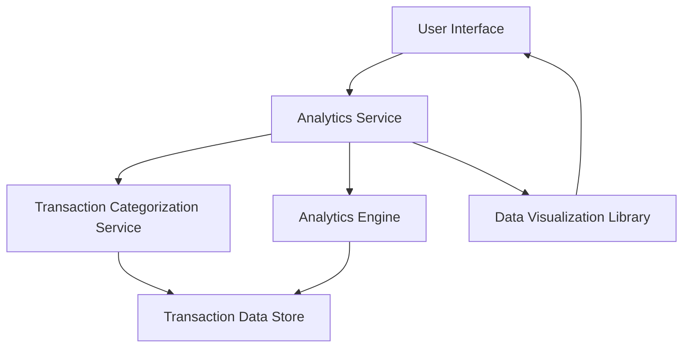

#### 1. High-Level Design

- **Summary:** This epic delivers interactive data visualizations and analytical capabilities that help users understand their spending patterns. Users can analyze monthly spend trends, view card-wise spending breakdowns, and explore category-wise spending distributions across nine predefined categories (Food & Dining, Fuel, Shopping, Travel, Entertainment, Utilities, Healthcare, Education, and Miscellaneous). The analytics provide actionable insights that enable users to identify spending trends, optimize budget allocation, and make data-driven financial decisions.

- **Component Flow:**

- **Integration Points:**
  - **Upstream:** Transaction data service (provides raw transaction data for analysis)
  - **Downstream:** Data visualization library (renders charts and graphs)
  - **Internal:** Transaction categorization service (categorizes transactions into 9 predefined categories), Analytics engine (performs data aggregation and calculations)

- **Key Assumptions:**
  - Transaction categorization is automated based on merchant codes or predefined rules; manual re-categorization is not in scope for this epic.
  - Historical data is available for at least 12 months to enable meaningful trend analysis.

- **NFR Highlights:** Analytics visualizations must render within 3 seconds; system must support interactive filtering and drill-down capabilities; charts must be responsive and accessible across all device types.

- **Data Flow:** User requests analytics through the UI → Analytics Service retrieves transaction data from Transaction Data Store → Transaction Categorization Service categorizes transactions into 9 categories → Analytics Engine aggregates data by month, card, and category → Data Visualization Library renders interactive charts (monthly trends, card-wise breakdown, category distribution) → Visualizations are displayed to the user with interactive filtering capabilities.

#### 2. Validation Report

- **Requirements Coverage:** The design fully covers the epic's stated scope including monthly spend trends visualization, card-wise spend analysis, category-wise spending breakdown across 9 categories, interactive charts and graphs, spending pattern identification, multi-dimensional analytics, and responsive analytics interface. All NFRs (3-second render time, interactive filtering, responsive design) are addressed through appropriate component selection and architecture. Integration dependencies with analytics engine, transaction categorization service, and data visualization library are properly identified and incorporated into the design.