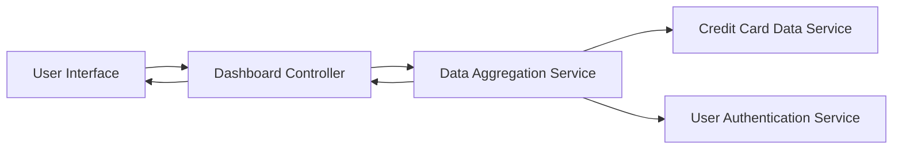

#### 1. High-Level Design

- **Summary:** This epic delivers a consolidated dashboard that displays key performance indicators (KPIs) for the user's credit card portfolio, including monthly spend, total credit limit, available credit, and outstanding amounts. The dashboard provides a single, responsive interface for real-time visibility into financial health and credit utilization across all credit cards.

- **Component Flow:**

- **Integration Points:**
  - **Upstream:** User Authentication Service (for user identity and session management)
  - **Upstream:** Credit Card Data Service (for retrieving card information and transaction data)
  - **Internal:** Data Aggregation Service (for consolidating multi-card KPIs)

- **Key Assumptions:**
  - Credit card data is available in a standardized format from the Credit Card Data Service with fields for limit, balance, and outstanding amounts.
  - Real-time refresh is achieved through polling or event-driven updates at intervals sufficient to meet the 2-second load requirement.

- **NFR Highlights:** Dashboard must load within 2 seconds, support responsive design for mobile and desktop, handle up to 20 credit cards per user, real-time data refresh capability.

#### 2. Validation Report

- **Requirements Coverage:** The design covers all stated scope elements: monthly spend display, total credit limit calculation, available credit tracking, outstanding amount monitoring, multi-card consolidated view, responsive dashboard layout, and KPI widgets. The architecture supports the NFRs for load time, responsiveness, scalability (20 cards), and real-time refresh. Integration with required services (Credit Card Data Service, User Authentication Service, Data Aggregation Service) is accounted for.