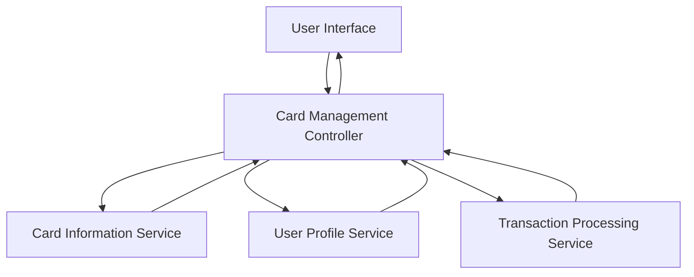

#### 1. High-Level Design

- **Summary:** This epic enables users to manage and view multiple credit cards within the dashboard. Users can access individual card details, perform card-wise spending analysis, and compare performance across cards. Each card displays specific metrics such as credit limit, available balance, and outstanding amount, supporting both independent card tracking and holistic portfolio management.

- **Component Flow:**

- **Integration Points:**
  - **Upstream:** Card Information Service (for retrieving individual card details and metadata)
  - **Upstream:** User Profile Service (for user-specific card associations and preferences)
  - **Upstream:** Transaction Processing Service (for card-wise transaction data and spending analysis)

- **Key Assumptions:**
  - Card information is synchronized from the Card Information Service with masked sensitive data (e.g., partial card numbers).
  - Card-wise spending analysis aggregates transaction data grouped by card identifier, with categorization handled by downstream services.

- **NFR Highlights:** System must support minimum 20 cards per user, card data synchronization within 5 seconds, secure card information display with masked sensitive data.

#### 2. Validation Report

- **Requirements Coverage:** The design addresses all scope elements: multiple card display, individual card details view, card-wise spend analysis, card comparison features, card status indicators, and per-card credit utilization metrics. The architecture supports the NFRs for scalability (minimum 20 cards), synchronization performance (5 seconds), and security (masked sensitive data). Integration with Card Information Service, User Profile Service, and Transaction Processing Service is included.