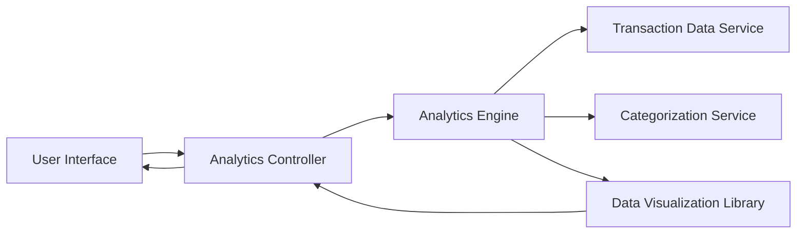

#### 1. High-Level Design

- **Summary:** This epic provides interactive visualizations and analytics to help users understand their spending patterns. Users can view monthly spend trends over time and analyze category-wise spending across predefined categories (Food & Dining, Fuel, Shopping, Travel, Entertainment, Utilities, Healthcare, Education, Miscellaneous). The analytics enable users to identify spending habits, track budget adherence, and make data-driven financial decisions.

- **Component Flow:**

- **Integration Points:**
  - **Upstream:** Transaction Data Service (for retrieving historical transaction records)
  - **Upstream:** Categorization Service (for automatic transaction categorization into predefined categories)
  - **Internal:** Analytics Engine (for processing and aggregating spending data)
  - **Internal:** Data Visualization Library (for rendering charts and graphs)

- **Key Assumptions:**
  - Transactions are pre-categorized by the Categorization Service or categorized on-demand using rule-based or ML-based classification.
  - Monthly spend trends are calculated from transaction history stored for up to 12 months, with data aggregated at monthly granularity.

- **NFR Highlights:** Analytics dashboard must render visualizations within 3 seconds, support interactive filtering and drill-down capabilities, handle transaction history of up to 12 months, maintain data accuracy of 99.9%.

#### 2. Validation Report

- **Requirements Coverage:** The design covers all scope elements: monthly spend trend visualization, category-wise spending analysis, interactive charts and graphs, spending pattern identification, multi-category breakdown, historical trend analysis, and transaction categorization. The architecture supports the NFRs for rendering performance (3 seconds), interactivity (filtering and drill-down), data retention (12 months), and accuracy (99.9%). Integration with Transaction Data Service, Analytics Engine, Data Visualization Library, and Categorization Service is accounted for.