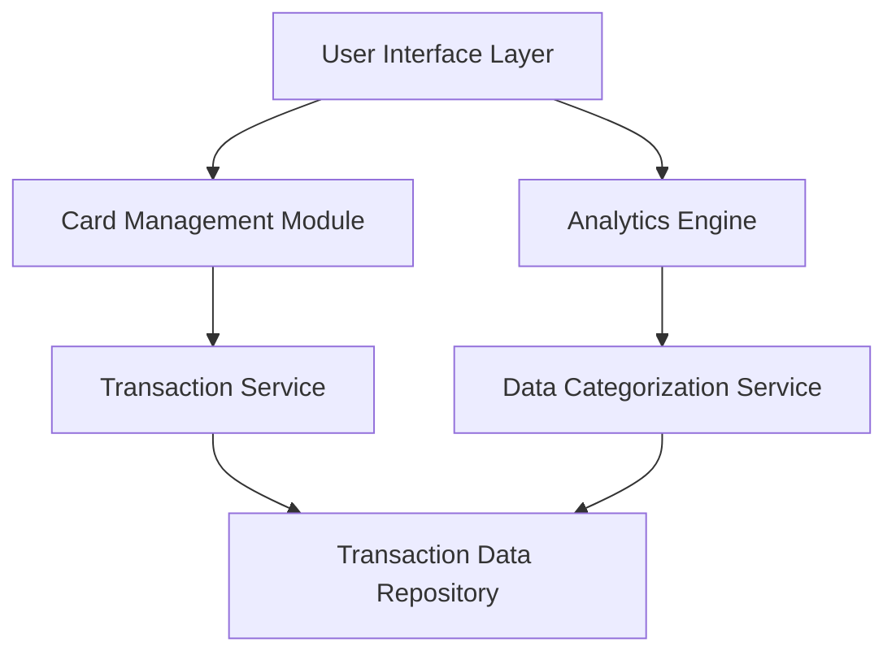

#### 1. High-Level Design

- **Summary:** This epic delivers a comprehensive credit card management and analytics platform that enables users to view multiple credit cards, track transactions, and analyze spending patterns across nine predefined categories. The solution provides interactive visualizations for monthly trends and card-wise spend analysis to help users optimize their financial behavior.

- **Component Flow:**

- **Integration Points:**
  - **Upstream:** Transaction data service or repository for retrieving historical transaction records
  - **Downstream:** Data categorization engine or service for classifying transactions into spending categories (Food & Dining, Fuel, Shopping, Travel, Entertainment, Utilities, Healthcare, Education, Miscellaneous)

- **Key Assumptions:**
  - Transaction data is pre-categorized or the categorization service provides real-time classification with acceptable latency
  - Monthly spend trends are calculated based on transaction timestamps; aggregation frequency is daily or near-real-time

- **NFR Highlights:** System must support visualization of multiple cards simultaneously; analytics charts must be interactive and responsive; category-wise data aggregation must be accurate and performant

- **Data Flow:** User accesses the UI to view credit cards → Card Management Module retrieves card details → Transaction Service fetches transaction history from the repository → Analytics Engine processes transactions and sends them to the Data Categorization Service → Categorized spending data is aggregated by category, month, and card → Interactive visualizations (charts/graphs) are rendered in the UI showing spending patterns, trends, and card-wise analysis.

#### 2. Validation Report

- **Requirements Coverage:** The design fully covers the epic's stated scope including multiple credit card display, transaction listing, category-wise spending visualization (9 categories), monthly spend trend analysis, card-wise spend analysis, interactive analytics charts, and spending pattern identification. All NFRs regarding multi-card visualization, interactive/responsive charts, and accurate aggregation are addressed through dedicated modules (Analytics Engine, Data Categorization Service). Integration dependencies with transaction data repository and categorization service are explicitly mapped in the architecture.