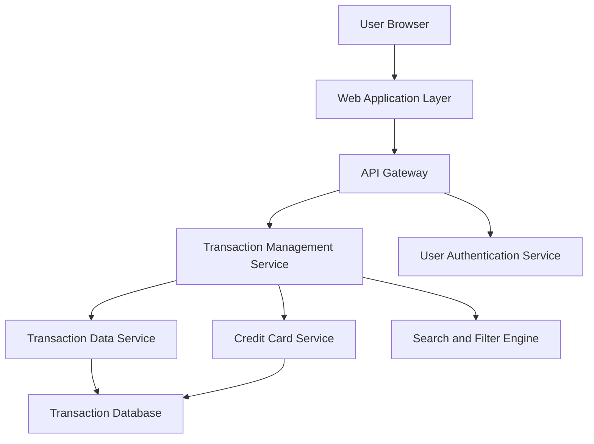

#### 1. High-Level Design

- **Summary:** This epic delivers comprehensive transaction tracking and monitoring capabilities, allowing users to view, search, and monitor all credit card transactions across their portfolio. Users can access detailed transaction histories for each card, search transactions, and filter by card, enabling complete visibility into spending activities and financial record-keeping.

- **Component Flow:**

- **Integration Points:**
  - **Upstream:** User Authentication Service (validates user access to transaction data), Credit Card Service (provides card metadata for filtering)
  - **Internal:** Transaction Data Service (retrieves transaction records), Search and Filter Engine (enables transaction search and card-wise filtering)
  - **Downstream:** Transaction Database (stores up to 10,000 transactions per user with indexed fields for fast retrieval)

- **Key Assumptions:** 
  - Transactions are stored with standardized timestamps (UTC) and indexed by user ID, card ID, and transaction date for fast retrieval
  - Search functionality supports basic text search on merchant name, amount, and date range; advanced search features are out of scope

- **NFR Highlights:** System must handle transaction volumes of up to 10,000 transactions per user; Transaction data retrieval latency must be under 300ms; Data must be displayed in chronological order

- **Data Flow:** User authenticates and selects transaction view → Transaction Management Service queries Transaction Data Service for user's transaction history → Credit Card Service provides card metadata for filtering options → Search and Filter Engine applies user-specified filters (card selection, date range, search terms) → Filtered transactions are retrieved from Transaction Database (indexed queries ensure sub-300ms latency) → Transactions are sorted in reverse chronological order → Web Application Layer renders transaction list with details (merchant, amount, date, card) → User can drill down into individual transaction details

#### 2. Validation Report

- **Requirements Coverage:** The design fully addresses the epic's scope by providing transaction listing, transaction details view, multi-card transaction support, transaction history access, transaction search functionality, and card-wise transaction filtering through the Transaction Management Service and Search and Filter Engine. NFRs for handling 10,000 transactions per user, sub-300ms retrieval latency, and chronological ordering are addressed through database indexing, optimized query patterns, and server-side sorting. All dependencies (transaction data service, credit card service, user authentication service, date/time service for timestamps) are explicitly mapped to architectural components. The design provides the foundation for spending analysis by ensuring comprehensive transaction data availability.