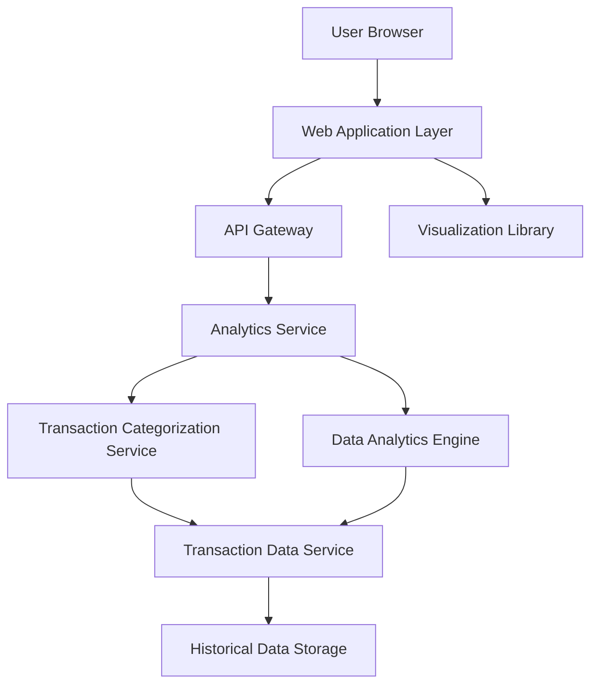

#### 1. High-Level Design

- **Summary:** This epic provides interactive visualizations and analytics capabilities that enable users to understand spending patterns across predefined categories (Food & Dining, Fuel, Shopping, Travel, Entertainment, Utilities, Healthcare, Education, Miscellaneous). The module delivers monthly spend trends, card-wise spend analysis, and category-wise spending breakdowns through responsive, interactive charts.

- **Component Flow:**

- **Integration Points:**
  - **Upstream:** Transaction Data Service (provides raw transaction data), Transaction Categorization Service (assigns spending categories to transactions)
  - **Internal:** Data Analytics Engine (aggregates and processes transaction data for trend analysis), Visualization Library (renders interactive charts in the browser)
  - **Downstream:** Historical Data Storage (stores up to 12 months of categorized transaction data for trend analysis)

- **Key Assumptions:** 
  - Transactions are pre-categorized by the Transaction Categorization Service using predefined rules or ML models
  - Historical data aggregation is performed in batch mode (daily/hourly) and cached for performance; real-time updates reflect current-day transactions only

- **NFR Highlights:** Analytics visualizations must render within 1 second; System must support real-time data aggregation for up to 12 months of historical data; Charts must be interactive and responsive across all device types

- **Data Flow:** User requests spending analytics → Analytics Service queries Transaction Data Service for historical transaction data (up to 12 months) → Transaction Categorization Service ensures all transactions are assigned to predefined categories → Data Analytics Engine aggregates spending by category, month, and card → Aggregated data is returned to Web Application Layer → Visualization Library renders interactive charts (category-wise pie/bar charts, monthly trend line charts, card-wise comparison charts) → User interacts with visualizations to filter and explore spending patterns

#### 2. Validation Report

- **Requirements Coverage:** The design comprehensively covers the epic's scope by providing category-wise spending visualization, monthly spend trend analysis, and card-wise spend analysis through dedicated Analytics Service and Visualization Library components. All nine predefined categories are supported via the Transaction Categorization Service. Interactive charts and spending pattern identification are enabled through the Visualization Library and Data Analytics Engine. NFRs for sub-1-second rendering, 12-month historical data support, and responsive interactivity are addressed through data caching, optimized aggregation, and client-side rendering strategies. All dependencies (transaction categorization, data analytics engine, visualization library, transaction data service, historical storage) are explicitly mapped to architectural components.