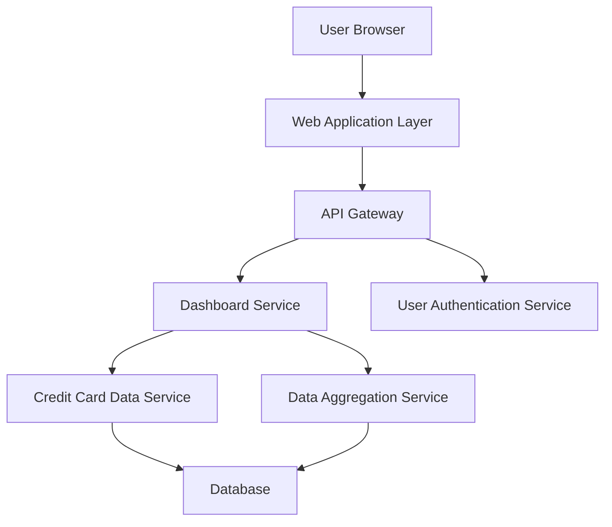

#### 1. High-Level Design

- **Summary:** This epic delivers a consolidated, real-time dashboard that aggregates and displays key performance indicators (KPIs) for all user credit cards. The dashboard provides a single-pane view of monthly spend, total credit limit, available credit, and outstanding amounts, enabling users to monitor their credit card portfolio health at a glance.

- **Component Flow:**

- **Integration Points:**
  - **Upstream:** User Authentication Service (validates user identity and session)
  - **Internal:** Credit Card Data Service (retrieves individual card details), Data Aggregation Service (calculates portfolio-level KPIs across multiple cards)
  - **Downstream:** Database (stores credit card data, transaction summaries, and calculated metrics)

- **Key Assumptions:** 
  - Credit card data is updated in near real-time (within 5-minute intervals) from source systems
  - KPI calculations (total credit limit, available credit, outstanding amounts) are performed server-side and cached for performance

- **NFR Highlights:** Dashboard must be responsive across desktop, tablet, and mobile devices; Real-time data refresh for KPI metrics; Page load time must be under 2 seconds

- **Data Flow:** User authenticates via Authentication Service → Dashboard Service queries Credit Card Data Service for individual card details → Data Aggregation Service calculates portfolio-level KPIs (sum of credit limits, total outstanding, total available credit, monthly spend) → Aggregated data is returned to Web Application Layer → Dashboard renders KPI widgets with real-time metrics → User views consolidated credit card portfolio snapshot

#### 2. Validation Report

- **Requirements Coverage:** The design fully addresses the epic's stated scope by providing a dashboard interface with all required KPI displays (monthly spend, total credit limit, available credit, outstanding amounts). The architecture supports multiple credit card display through the Data Aggregation Service and ensures responsive layout via the Web Application Layer. All NFRs (responsiveness, real-time refresh, sub-2-second load time) are addressed through caching, server-side aggregation, and optimized data retrieval patterns. Dependencies on credit card data service, user authentication, and data aggregation are explicitly mapped to architectural components.