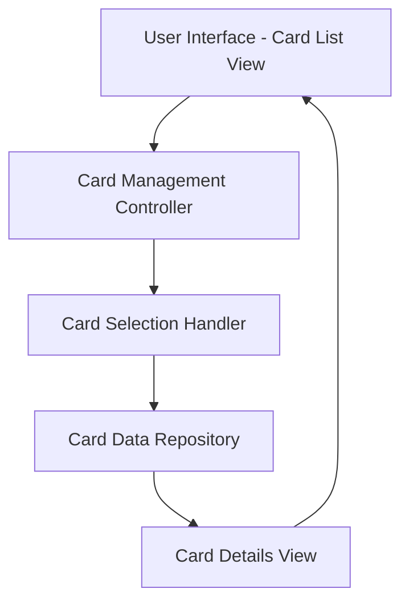

#### 1. High-Level Design

- **Summary:** This epic enables users to manage and view multiple credit cards within a single centralized interface. Users can view all credit cards with relevant details, switch between cards, and access card-specific information including limits, balances, and status. The feature supports tracking each card separately while maintaining aggregated views across all cards.

- **Component Flow:**

- **Integration Points:** 
  - **Upstream:** Credit card data repository or service providing card details, balances, and transaction history for multiple cards
  - **Downstream:** User interface components for card display, selection, and switching functionality

- **Key Assumptions:** 
  - Each user can have up to 10 credit cards as per NFR specification
  - Card data is retrieved per user session with caching mechanisms to ensure seamless switching with minimal latency

- **NFR Highlights:** System must handle at least 10 credit cards per user; card switching and data loading must be seamless with minimal latency; data accuracy must be maintained across all card views

#### 2. Validation Report

- **Requirements Coverage:** The design addresses all scope items including multiple credit card display, card-specific details view, card selection and switching functionality, card-wise spend analysis, individual card balance and limit tracking, and card status indicators. The architecture supports the NFR requirement of handling 10+ cards with seamless switching and maintains data accuracy through centralized data repository access.