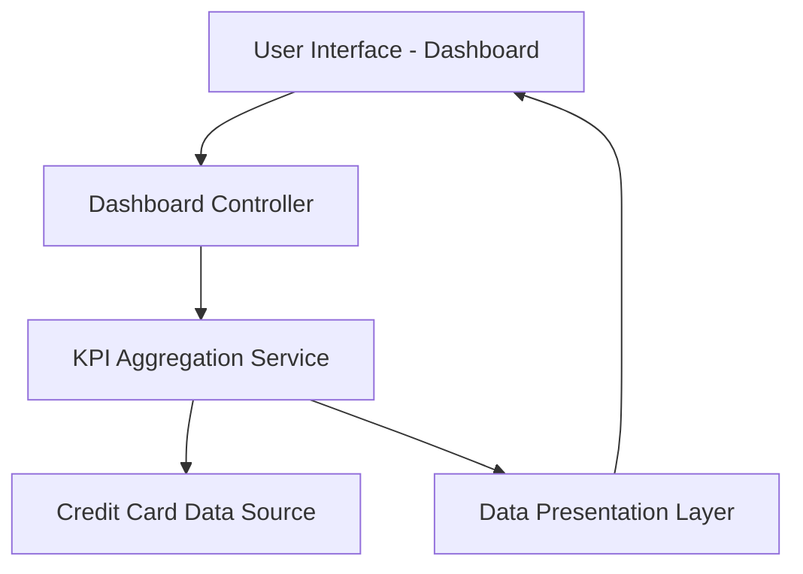

#### 1. High-Level Design

- **Summary:** This epic delivers a responsive dashboard that consolidates credit card portfolio data and displays key performance indicators (KPIs) including monthly spend, total credit limit, available credit, and outstanding amounts. The dashboard aggregates data from multiple credit cards into a unified view, enabling users to monitor their financial health and make informed credit management decisions.

- **Component Flow:**

- **Integration Points:** 
  - **Upstream:** Credit card data source or mock data service providing card balances, limits, and transaction data
  - **Downstream:** User interface components for responsive display across desktop, tablet, and mobile devices

- **Key Assumptions:** 
  - Data is provided in a structured format (JSON/XML) from the credit card data source with standardized field names
  - Near-real-time data refresh is achieved through periodic polling or event-driven updates (frequency not specified in epic)

- **NFR Highlights:** Dashboard must be responsive across desktop, tablet, and mobile devices; optimized page load time; supports real-time or near-real-time data refresh

#### 2. Validation Report

- **Requirements Coverage:** The design fully covers the epic's stated scope including dashboard KPI display, monthly spend calculation, credit limit aggregation, available credit calculation, outstanding amount tracking, responsive layout, and multi-card consolidated view. All NFRs regarding responsiveness, performance, and data refresh are addressed through the component architecture.