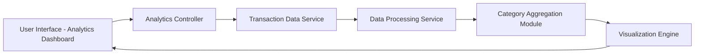

#### 1. High-Level Design

- **Summary:** This epic provides comprehensive spending analytics and transaction visualization capabilities to help users understand spending patterns and financial behavior. It includes interactive visualizations for category-wise spending analysis across 9 predefined categories (Food & Dining, Fuel, Shopping, Travel, Entertainment, Utilities, Healthcare, Education, Miscellaneous), monthly spend trends, and time-based spending analysis with card-wise breakdowns.

- **Component Flow:**

- **Integration Points:** 
  - **Upstream:** Transaction data service or repository providing categorized transaction history
  - **Upstream:** Data processing service for aggregating and categorizing transactions
  - **Downstream:** Interactive charts and visualization components for rendering analytics

- **Key Assumptions:** 
  - Transactions are pre-categorized by the upstream transaction data service into the 9 predefined categories
  - Historical transaction data is available for at least 12 months to support meaningful trend analysis

- **NFR Highlights:** Analytics visualizations must load within acceptable timeframes even with large transaction datasets; charts must be interactive and responsive; data aggregation must be accurate and consistent

#### 2. Validation Report

- **Requirements Coverage:** The design comprehensively covers all scope elements including category-wise spending visualization, monthly spend trend analysis, interactive charts and graphs, transaction categorization across 9 categories, spending pattern identification, time-based spending analysis, and card-wise spend breakdown. The architecture incorporates separate modules for data processing, category aggregation, and visualization to meet NFRs for performance, interactivity, and data accuracy.