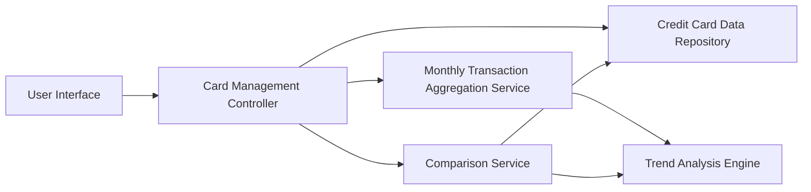

#### 1. High-Level Design

**Summary:** This epic provides multi-card portfolio management capabilities, enabling users to view, compare, and analyze spending across multiple credit cards from a unified interface. The solution delivers card-wise spend breakdowns, monthly trend visualizations, and comparative analytics to optimize credit utilization and spending behavior across the user's card portfolio.

**Component Flow:**

**Integration Points:**
- **Upstream:** Credit card data repository (for card information, balances, limits)
- **Upstream:** Monthly transaction aggregation service (for trend analysis and spend calculations)
- **Data Source:** Credit card database and transaction aggregation data store

**Key Assumptions:**
- System supports at least 10 cards per user with scalable architecture for future expansion
- Monthly spend trends assume data aggregated at monthly granularity with historical data retained for at least 12-24 months

**NFR Highlights:** System must support management of at least 10 credit cards per user, card data retrieval must complete within 1 second, support concurrent access for multiple users

#### 2. Validation Report

**Requirements Coverage:** The design fully satisfies the epic's requirements by incorporating multi-card display, card-wise spend breakdown, monthly trend visualization, and comparison features. The architecture supports the NFR constraint of 1-second card data retrieval through direct repository access and optimized queries. The dedicated trend analysis engine and comparison service enable sophisticated analytics while maintaining performance. Concurrent user access is supported through stateless controller design and scalable service architecture.