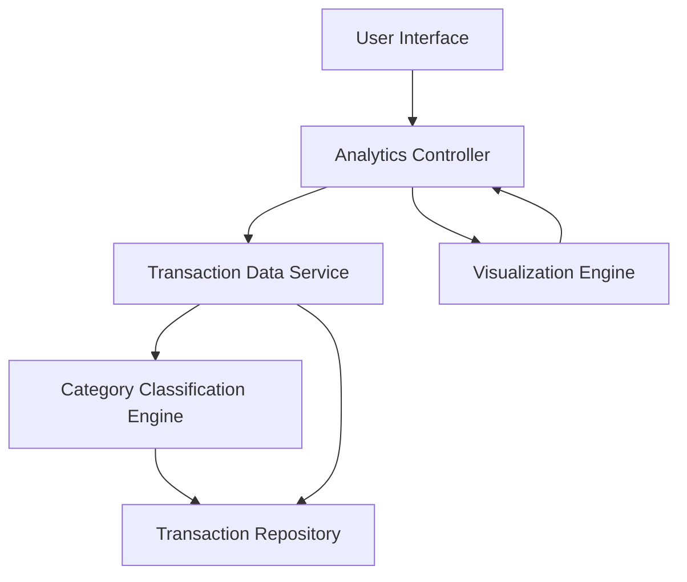

#### 1. High-Level Design

**Summary:** This epic enables comprehensive transaction viewing and category-wise spending analytics across nine predefined categories (Food & Dining, Fuel, Shopping, Travel, Entertainment, Utilities, Healthcare, Education, Miscellaneous). Users can visualize spending patterns through interactive charts and graphs to identify optimization opportunities and improve financial decision-making.

**Component Flow:**

**Integration Points:**
- **Upstream:** Transaction data service (for retrieving transaction history)
- **Upstream:** Category classification engine (for transaction categorization into 9 predefined categories)
- **Data Source:** Transaction repository/database

**Key Assumptions:**
- Transactions are pre-categorized by the classification engine or categorized on-the-fly (assumed batch categorization nightly with real-time override capability)
- Pagination strategy uses cursor-based or offset-based pagination for handling 1000+ transactions

**NFR Highlights:** Analytics visualizations must render within 3 seconds, support filtering and sorting of transactions, handle display of up to 1000 transactions per view with pagination

#### 2. Validation Report

**Requirements Coverage:** The design comprehensively addresses the epic's scope by including transaction listing capabilities, category-wise visualization across all 9 specified categories, and interactive charting functionality. The architecture supports the NFR requirements through dedicated visualization engine and pagination support. The separation of the category classification engine ensures extensibility and maintainability. Filtering and sorting capabilities are implicitly supported through the analytics controller layer.