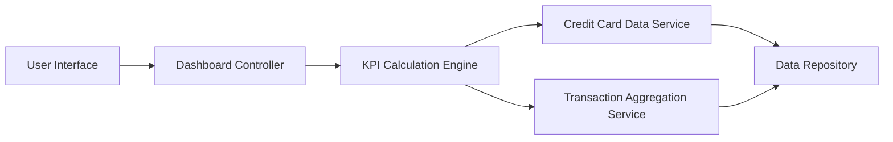

#### 1. High-Level Design

**Summary:** This epic delivers a centralized financial dashboard that aggregates and displays key performance indicators (KPIs) for credit card portfolio management, including monthly spend, total credit limit, available credit, and outstanding amount. The dashboard provides real-time visibility into financial health through a responsive, modern interface accessible across devices.

**Component Flow:**

**Integration Points:**
- **Upstream:** Credit card data service (for fetching card balances and credit limits)
- **Upstream:** Transaction data aggregation service (for monthly spend calculations)
- **Data Source:** Credit card data repository and transaction database

**Key Assumptions:**
- KPI data is refreshed in near real-time (assumed refresh interval: every 5-15 minutes or on-demand)
- Dashboard assumes standardized data formats from credit card and transaction services (JSON/REST APIs)

**NFR Highlights:** Dashboard must load within 2 seconds, support responsive design across mobile and desktop devices, handle real-time data refresh for KPI metrics

#### 2. Validation Report

**Requirements Coverage:** The design fully covers the epic's stated scope by incorporating all required KPI widgets (monthly spend, total credit limit, available credit, outstanding amount), responsive layout, and integration with necessary data services. The component flow demonstrates clear separation of concerns with dedicated services for data retrieval and KPI calculation, ensuring the 2-second load time requirement can be met through efficient data aggregation and caching strategies.