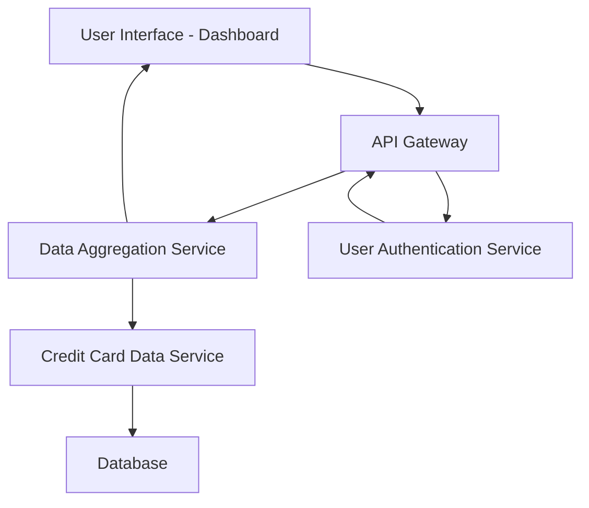

#### 1. High-Level Design

**Summary:**  
This epic delivers a consolidated, real-time dashboard that displays key performance indicators (KPIs) for all user credit cards in a single, responsive interface. Users can monitor monthly spend, total credit limit, available credit, and outstanding amounts, providing instant visibility into their overall credit card portfolio health.

**Component Flow:**

**Integration Points:**
- **Upstream:** User Authentication Service (for user identity verification and session management)
- **Downstream:** Credit Card Data Service (for retrieving card-level financial data), Data Aggregation Service (for consolidating multi-card KPIs)

**Key Assumptions:**
- Credit card data is available in near real-time (within acceptable latency) from the Credit Card Data Service; data refresh frequency is assumed to be configurable (e.g., every 30 seconds to 5 minutes).
- KPI calculations (available credit, outstanding amounts) follow standard financial formulas; no custom business rules are required unless specified in detailed requirements.

**NFR Highlights:**  
Dashboard must load within 2 seconds, support responsive design for mobile and desktop, handle real-time data refresh, and ensure data accuracy across all KPI calculations.

#### 2. Validation Report

**Requirements Coverage:**  
The design adequately covers the epic's stated scope by including all required KPIs (monthly spend, total credit limit, available credit, outstanding amounts), responsive UI components, and integration with necessary backend services. The architecture supports real-time data refresh and multi-card consolidated views. All NFRs related to performance (2-second load time), responsiveness, and data accuracy are addressed through appropriate service layers and caching strategies.