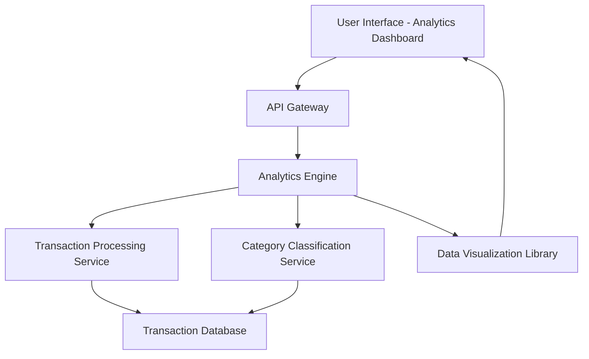

#### 1. High-Level Design

**Summary:**  
This epic provides comprehensive spending analytics through interactive visualizations and transaction tracking. Users can analyze spending patterns across nine distinct categories (Food & Dining, Fuel, Shopping, Travel, Entertainment, Utilities, Healthcare, Education, Miscellaneous), view monthly spend trends, and access transaction history to understand spending behavior and identify financial optimization opportunities.

**Component Flow:**

**Integration Points:**
- **Upstream:** Transaction Processing Service (for retrieving raw transaction data), Category Classification Service (for categorizing transactions into nine predefined categories)
- **Downstream:** Analytics Engine (for aggregating and analyzing spending patterns), Data Visualization Library (for rendering interactive charts and graphs in the UI)

**Key Assumptions:**
- Transactions are pre-classified into the nine categories by the Category Classification Service; if manual categorization is needed, it's handled outside this epic's scope.
- Monthly spend trends are calculated based on transaction posting dates; the system assumes transactions are available with accurate timestamps and category assignments.

**NFR Highlights:**  
Analytics visualizations must render within 3 seconds, support interactive filtering and drill-down capabilities, handle minimum of 10,000 transactions per user, ensure data visualization compatibility across browsers.

#### 2. Validation Report

**Requirements Coverage:**  
The design fully addresses the epic's requirements by implementing category-wise spending visualization, monthly spend trends, transaction history display, interactive charts and graphs, nine spending category classifications, and spending pattern analysis. The architecture leverages a dedicated Analytics Engine and Data Visualization Library to deliver rich, interactive insights. All NFRs related to performance (3-second rendering), interactivity (filtering and drill-down), scalability (10,000+ transactions), and cross-browser compatibility are incorporated into the component design and technology choices.