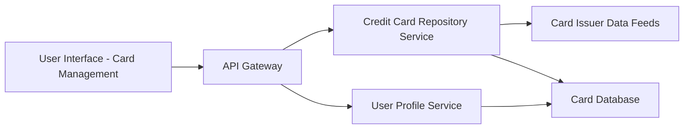

#### 1. High-Level Design

**Summary:**  
This epic enables users to manage and view multiple credit cards within the dashboard, displaying individual card details, card-specific spending patterns, and card-wise spend analysis. Users can compare performance across their credit card portfolio to make informed decisions about card usage based on individual card benefits and spending patterns.

**Component Flow:**

**Integration Points:**
- **Upstream:** User Profile Service (for user-specific card associations and preferences)
- **Downstream:** Credit Card Repository Service (for retrieving individual card details and balances), Card Issuer Data Feeds (for real-time card data synchronization)

**Key Assumptions:**
- Card data is masked appropriately (e.g., showing last 4 digits only) by the Credit Card Repository Service before being sent to the UI; masking rules follow PCI-DSS standards.
- The system supports up to 50 cards per user as specified; pagination or lazy loading is implemented for optimal performance when displaying large card portfolios.

**NFR Highlights:**  
System must support display of up to 50 credit cards per user, card data retrieval must complete within 1 second, ensure secure display of sensitive card information with appropriate masking.

#### 2. Validation Report

**Requirements Coverage:**  
The design comprehensively covers the epic's scope by enabling multiple credit card display, card-wise spend analysis, individual card details view, card comparison capabilities, and card-specific balance tracking. The architecture integrates with the Credit Card Repository Service and Card Issuer Data Feeds to ensure accurate, up-to-date card information. NFRs around performance (1-second retrieval), scalability (50 cards per user), and security (data masking) are addressed through appropriate service design and security controls.