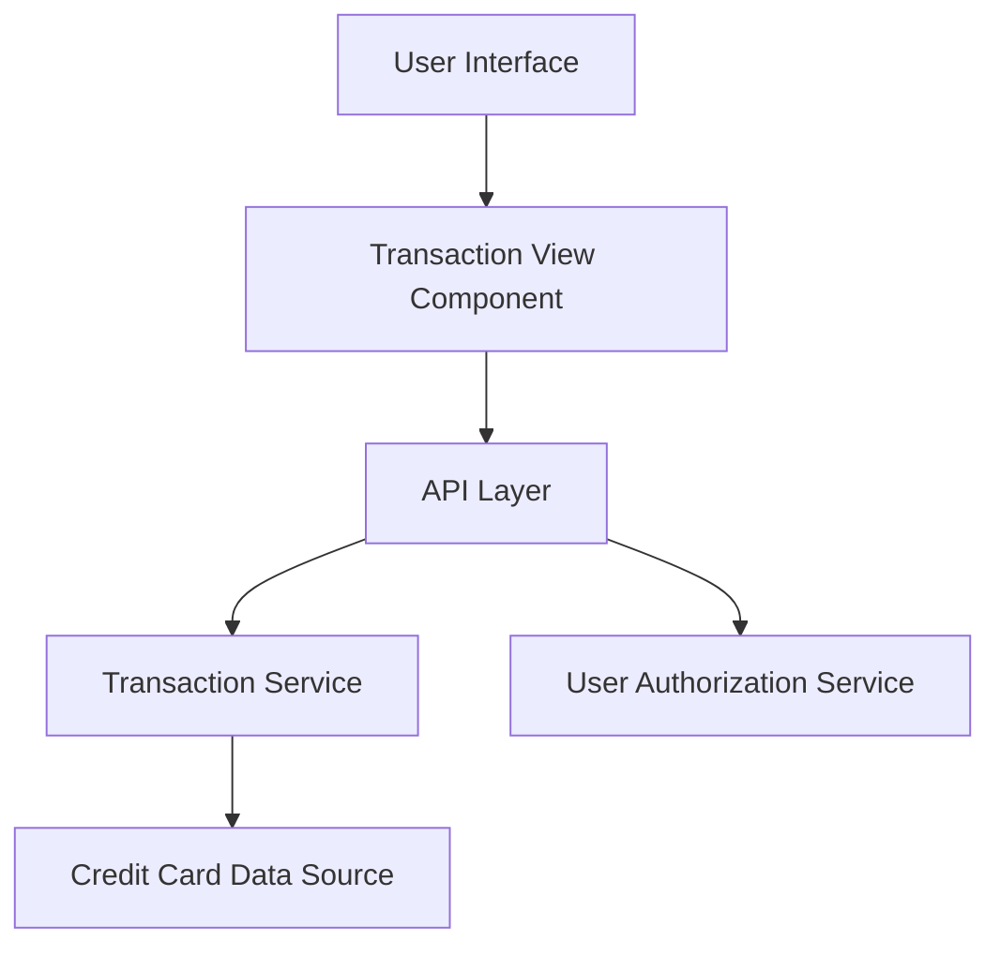

### 1. High-Level Design

**Summary:** This epic enables users to view and manage comprehensive credit card transaction history across all their cards, providing detailed transaction-level data that supports expense tracking, budget management, and financial planning while maintaining data integrity and performance.

**Component Flow:**

**Integration Points:**
- **Upstream:** Credit card data sources (for transaction information)
- **Upstream:** User authorization service (for access control)
- **Downstream:** Dashboard KPI system (provides transaction data for spending calculations)
- **Lateral:** Integrates with dashboard components for unified user experience

**Key Assumptions:**
- Transaction data is retrieved via paginated API calls to handle large volumes efficiently; transaction records are read-only with no modification capabilities in this scope.

**NFR Highlights:** Efficient handling and display of large transaction volumes; acceptable response times for transaction queries; maintained data integrity for all transaction records.

### 2. Validation Report

**Requirements Coverage:** The design covers all scope elements including transaction listing functionality, transaction detail views, multi-card transaction support, transaction data retrieval and display, transaction history access, and responsive transaction interface. The architecture supports NFRs through dedicated transaction service layer with query optimization and integration with authorization services for secure access.