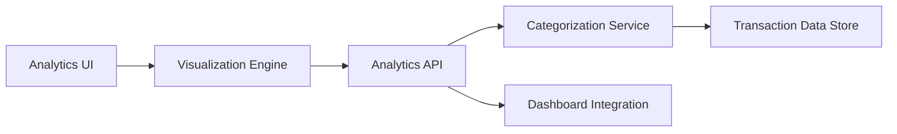

### 1. High-Level Design

**Summary:** This epic delivers interactive analytical capabilities enabling users to gain insights into spending patterns through automated transaction categorization (Food & Dining, Fuel, Shopping, Travel, Entertainment, Utilities, Healthcare, Education, Miscellaneous), visual analytics with charts/graphs, card-wise spending distribution, and monthly trend analysis for data-driven financial decision-making.

**Component Flow:**

**Integration Points:**
- **Upstream:** Transaction Management system (source of transaction data)
- **Upstream:** Categorization logic or service (for transaction classification)
- **Downstream:** Dashboard KPIs (for consistent data presentation)
- **Lateral:** Integrates with main dashboard for unified analytics experience

**Key Assumptions:**
- Transaction categorization uses rule-based or ML-based classification applied at data ingestion or query time; aggregated analytics data may be pre-computed and cached for performance optimization.

**NFR Highlights:** Efficient visualization rendering with large datasets; accurate and consistent analytics calculations; minimal latency for interactive elements; support for concurrent users accessing analytics simultaneously.

### 2. Validation Report

**Requirements Coverage:** The design comprehensively addresses all scope items including category-wise spending visualization, monthly spend trend analysis, card-wise spend analysis, interactive charts and graphs, spending pattern identification, multi-category support for all 9 specified categories, and analytical dashboard components. The architecture supports all stated NFRs through dedicated visualization engine, categorization service, and optimized data access patterns for concurrent user support.