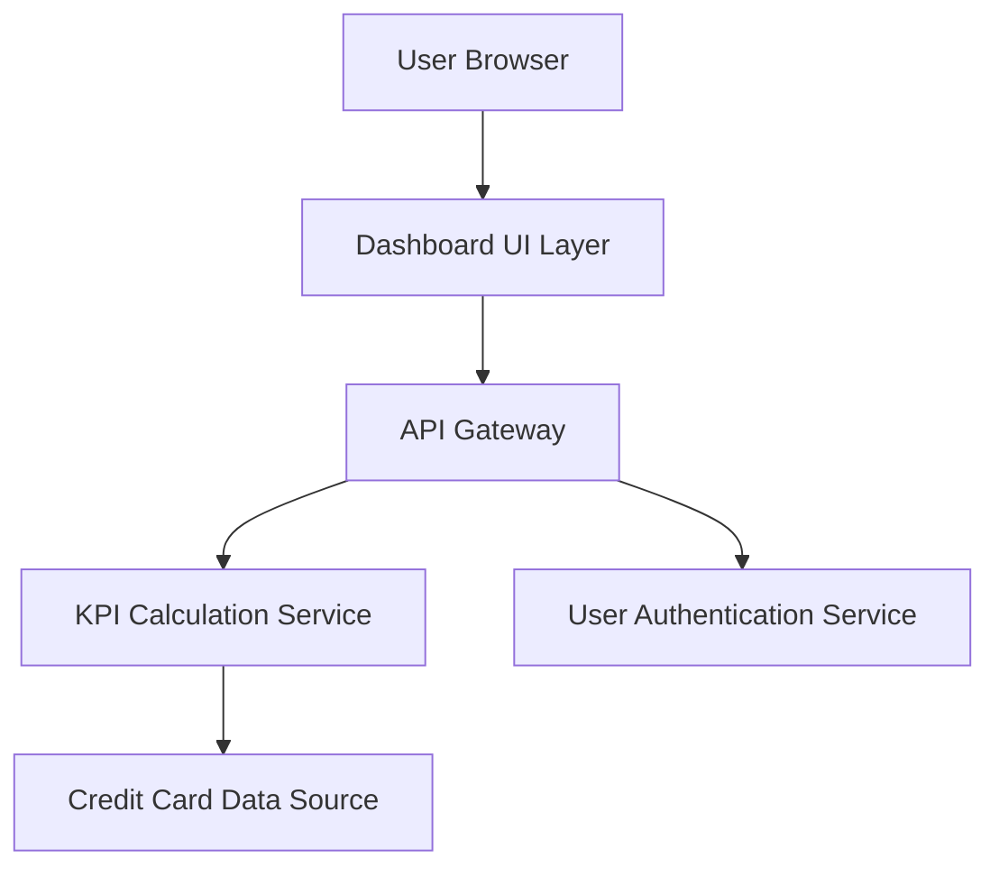

### 1. High-Level Design

**Summary:** This epic delivers a centralized, responsive dashboard that consolidates all credit card information and key performance indicators (monthly spend, total credit limit, available credit, outstanding amounts) into a single unified interface, enabling users to monitor their financial health and credit utilization in real-time or near real-time.

**Component Flow:**

**Integration Points:**
- **Upstream:** Credit card data sources (for card details, transaction data, balance information)
- **Upstream:** User authentication service (for secure access control)
- **Downstream:** Provides consolidated view consumed by end users via web/mobile interfaces

**Key Assumptions:**
- Credit card data sources expose RESTful APIs or similar interfaces for data retrieval; KPI calculations are performed server-side with caching to optimize performance.

**NFR Highlights:** Responsive layouts across desktop, tablet, and mobile devices; dashboard load and KPI display within acceptable performance thresholds; real-time or near real-time data accuracy.

### 2. Validation Report

**Requirements Coverage:** The design addresses all stated scope items including dashboard interface development, multiple credit card display, monthly spend tracking, credit limit calculation, available credit computation, outstanding amount tracking, responsive layout implementation, and KPI visualization components. The architecture supports the NFRs for responsiveness, performance, and data accuracy through dedicated calculation services and authentication integration.