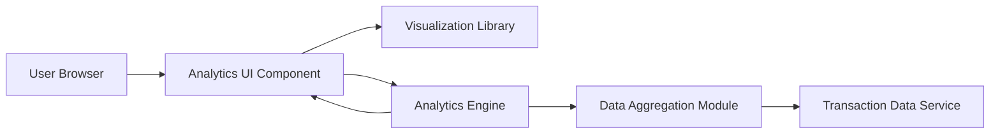

#### 1. High-Level Design

- **Summary:** This epic delivers interactive data visualizations and analytical capabilities enabling users to understand spending patterns across multiple dimensions. The system provides category-wise spending breakdowns across nine predefined categories (Food & Dining, Fuel, Shopping, Travel, Entertainment, Utilities, Healthcare, Education, Miscellaneous), monthly spend trend analysis, and card-wise spend comparisons to support informed financial decision-making.

- **Component Flow:**

- **Integration Points:**
  - **Upstream:** Transaction data service for raw spending data and transaction details
  - **Downstream:** Analytics engine or calculation service for aggregating and processing spending data; Visualization library for rendering interactive charts

- **Key Assumptions:**
  - Transactions are pre-categorized or automatically categorized into the nine predefined spending categories at the time of transaction ingestion.
  - Monthly trend analysis covers a rolling 12-month period unless user specifies a different time range.

- **NFR Highlights:** Visualizations must render efficiently with large datasets; charts and graphs must be interactive and responsive; analytics calculations performed with accuracy; system supports data aggregation across multiple time periods.

#### 2. Validation Report

- **Requirements Coverage:** The design comprehensively covers all analytical requirements including category-wise visualization across nine categories, monthly trend charts, card-wise spend analysis, and interactive visualizations. The architecture separates concerns between data aggregation, analytics processing, and visualization rendering for optimal performance. Integration points align with specified dependencies for transaction data service, analytics engine, and visualization library. All stated NFRs for efficiency, interactivity, accuracy, and multi-period aggregation are addressed in the design.