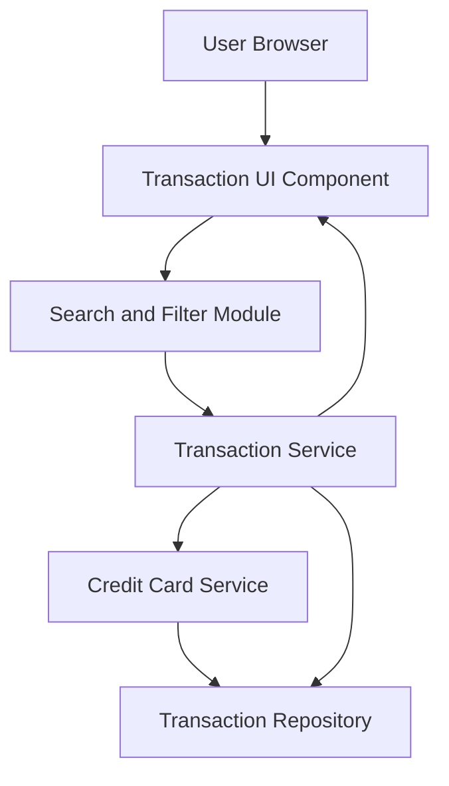

#### 1. High-Level Design

- **Summary:** This epic provides comprehensive transaction visibility across all credit cards, enabling users to view, search, filter, and analyze individual transactions. The system aggregates transactions from multiple cards into a centralized interface, providing transparency and enabling users to monitor all card activities and spending behavior.

- **Component Flow:**

- **Integration Points:**
  - **Upstream:** Credit card service for linking transactions to specific cards and card metadata
  - **Downstream:** Transaction data service or repository for storing and retrieving transaction records

- **Key Assumptions:**
  - Transactions are stored with standardized attributes (date, amount, merchant, category, card ID) to enable consistent search and filtering.
  - Transaction history is available for a defined retention period (e.g., 12-24 months) without explicit specification in the epic.

- **NFR Highlights:** System must efficiently handle and display large transaction volumes; transaction data displayed with minimal latency; interface maintains responsiveness when loading transaction history.

#### 2. Validation Report

- **Requirements Coverage:** The design addresses all core requirements including transaction listing, detail display, multi-card aggregation, search and filter capabilities, and history access. The component architecture supports efficient data retrieval and presentation with dedicated search/filter module. Integration points align with specified dependencies for transaction data service and credit card service. NFRs for performance and responsiveness are incorporated into the design.