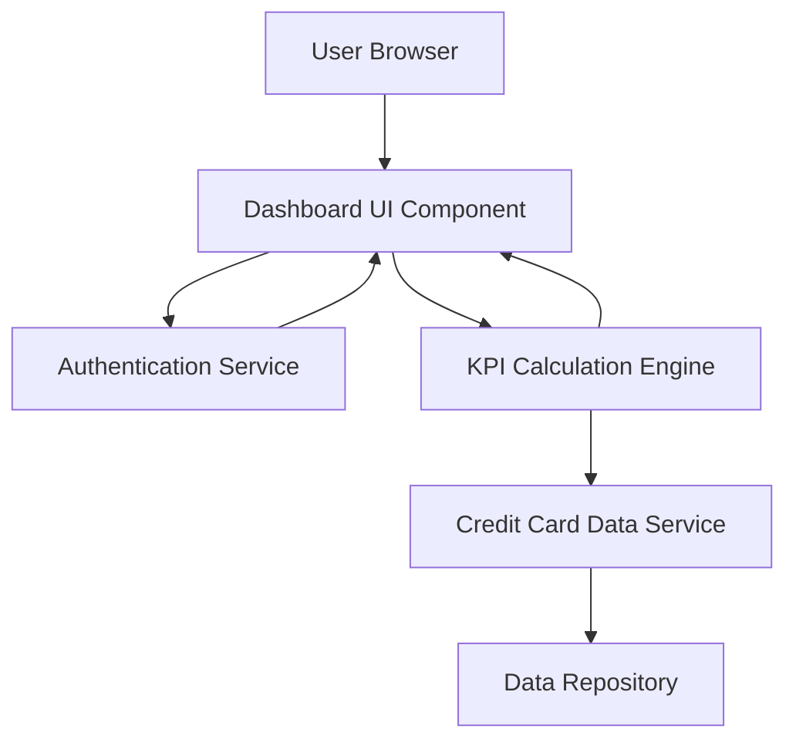

#### 1. High-Level Design

- **Summary:** This epic delivers a responsive dashboard interface that consolidates credit card portfolio information, displaying key performance indicators including monthly spend, total credit limit, available credit, and outstanding amounts. The dashboard serves as the primary entry point for users to monitor their overall credit card health across multiple cards from a unified interface.

- **Component Flow:**

- **Integration Points:**
  - **Upstream:** User authentication service for secure access to personal financial data
  - **Downstream:** Credit card data source or mock data service for retrieving card information and balances

- **Key Assumptions:**
  - Credit card data is refreshed in near real-time or at regular intervals (e.g., hourly) to ensure KPIs reflect current state.
  - Available credit is calculated as (Total Credit Limit - Outstanding Amount) without considering pending transactions.

- **NFR Highlights:** Dashboard must be responsive across desktop, tablet, and mobile devices; page load time optimized for quick KPI access; real-time calculation support for available credit and outstanding amounts.

#### 2. Validation Report

- **Requirements Coverage:** The design fully covers the epic's stated scope including dashboard interface, all four KPIs (monthly spend, total credit limit, available credit, outstanding amount), multi-card view, and responsive layout. The component flow addresses authentication, data retrieval, calculation, and presentation layers. Integration points align with specified dependencies for authentication and credit card data services.