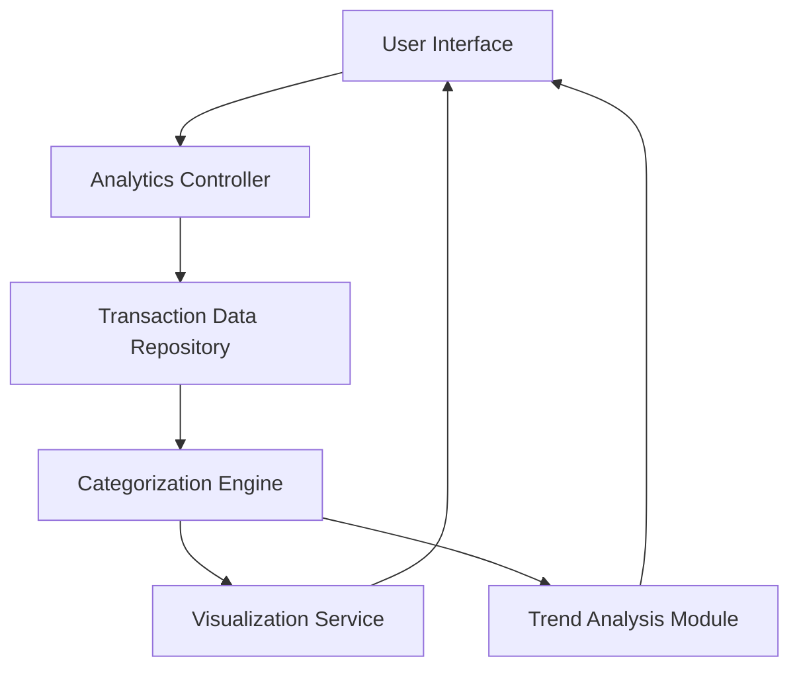

#### 1. High-Level Design

- **Summary:** This epic provides interactive visualizations and analytics capabilities enabling users to analyze spending patterns across nine predefined categories (Food & Dining, Fuel, Shopping, Travel, Entertainment, Utilities, Healthcare, Education, Miscellaneous). The solution delivers category-wise breakdowns, monthly spend trends, and card-wise spend analysis to support informed financial decision-making.

- **Component Flow:**

- **Integration Points:** 
  - Transaction data repository for historical spending data
  - Data categorization service or engine to classify transactions into predefined categories
  - Potential integration with card management system for card-wise spend analysis

- **Key Assumptions:** 
  - Transactions are pre-categorized or categorization rules/ML models are available for automatic classification
  - Historical data retention period is sufficient for meaningful trend analysis (assumed minimum 12 months)

- **NFR Highlights:** Analytics visualizations must render within acceptable time frames for large transaction datasets; System must support filtering and drill-down capabilities; Charts must be responsive and interactive across all device types

#### 2. Validation Report

- **Requirements Coverage:** The design addresses all scope elements including category-wise spending visualization, monthly spend trends analysis, card-wise spend analysis, interactive charts and graphs, nine spending categories support, and spending pattern identification. The component flow incorporates a categorization engine for transaction classification and separate modules for visualization and trend analysis, ensuring comprehensive analytics capabilities. NFR requirements for performance, interactivity, and responsiveness are acknowledged in the architecture.