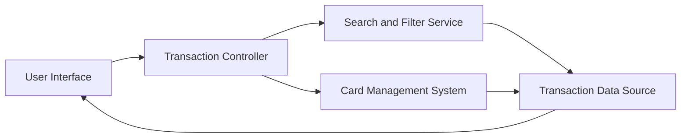

#### 1. High-Level Design

- **Summary:** This epic delivers comprehensive transaction viewing and monitoring capabilities across all credit cards, enabling users to access detailed transaction histories, view transaction details, and monitor spending activities. The solution provides a unified interface for tracking credit card usage, verifying charges, and maintaining awareness of all financial activities across the user's credit card portfolio.

- **Component Flow:**

- **Integration Points:** 
  - Transaction data source or database for storing and retrieving transaction records
  - Card management system for linking transactions to specific cards
  - Potential integration with real-time transaction feed for monitoring capabilities

- **Key Assumptions:** 
  - Transaction data includes sufficient metadata for filtering and search operations (date, amount, merchant, category)
  - Pagination or lazy loading strategy will be implemented with default page size (assumed 50-100 transactions per page)

- **NFR Highlights:** Transaction list must support pagination or lazy loading for large datasets; Search and filter operations must return results within acceptable response times; Interface must handle high volume of transaction records efficiently

#### 2. Validation Report

- **Requirements Coverage:** The design covers all stated scope elements including transaction list view, transaction detail display, multi-card transaction aggregation, transaction history access, transaction filtering and search, and responsive transaction interface. The component flow incorporates dedicated search and filter services to handle large datasets efficiently, and establishes integration with both transaction data sources and card management systems for comprehensive transaction tracking. NFR requirements for pagination, search performance, and high-volume handling are addressed in the architecture.