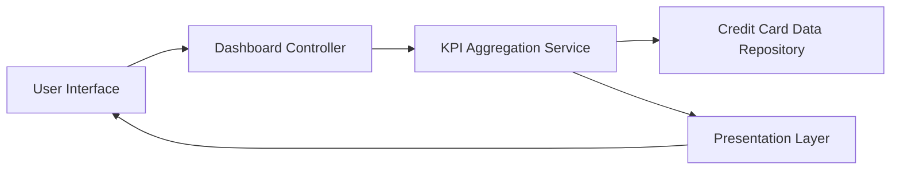

#### 1. High-Level Design

- **Summary:** This epic delivers a consolidated dashboard interface that displays multiple credit cards with key performance indicators (KPIs) including monthly spend, total credit limit, available credit, and outstanding amounts. The solution provides users with immediate visibility into their credit card portfolio and overall financial health through a modern, responsive interface.

- **Component Flow:**

- **Integration Points:** 
  - Credit card data source or repository for card details and balances
  - Data aggregation service for calculating KPIs across multiple cards
  - Potential integration with backend card management system for real-time data

- **Key Assumptions:** 
  - Credit card data is available in a structured format with consistent schema across all cards
  - KPI calculations are performed server-side with periodic refresh intervals (not true real-time streaming)

- **NFR Highlights:** Dashboard must be responsive across desktop, tablet, and mobile devices; Page load time should support real-time KPI updates; UI must handle display of multiple credit cards without performance degradation

#### 2. Validation Report

- **Requirements Coverage:** The design covers all stated scope elements including dashboard KPIs display, multiple credit card view, monthly spend tracking, credit limit display, available credit calculation, outstanding amount tracking, and responsive layout. The component flow addresses the need for data aggregation across multiple cards and presentation through a responsive UI. Integration dependencies are identified and aligned with the epic's requirements.