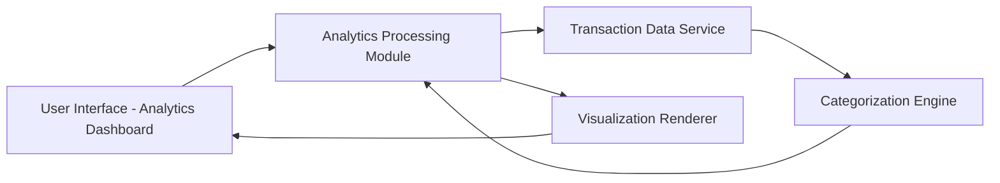

#### 1. High-Level Design

- **Summary:** This epic provides interactive visualizations and analytics to help users understand spending patterns across predefined categories (Food & Dining, Fuel, Shopping, Travel, Entertainment, Utilities, Healthcare, Education, and Miscellaneous). The feature includes a transaction categorization engine, visual charts, and spending pattern analysis to support informed budgeting decisions.

- **Component Flow:**

- **Integration Points:**
  - **Upstream:** Transaction data service for retrieving detailed transaction records
  - **Internal:** Categorization service or algorithm for automatic transaction classification into predefined categories
  - **Upstream:** Dashboard service for displaying analytics and visualizations in the main dashboard context

- **Key Assumptions:**
  - Transaction categorization is performed automatically using a rule-based or ML-based algorithm; manual categorization is not in scope
  - Historical transaction data is available for trend analysis, with retention period defined by the transaction data service

- **NFR Highlights:** Analytics engine must process and categorize transactions efficiently; Visualizations must render quickly even with large transaction datasets; System must support historical data analysis for trend identification

#### 2. Validation Report

- **Requirements Coverage:** The design comprehensively covers all requirements including category-wise spending visualization, interactive charts and graphs, transaction categorization engine, spending pattern analysis, multi-category support for all nine specified categories, and transaction history display. The architecture ensures efficient processing and rendering for large datasets through dedicated analytics and visualization components.