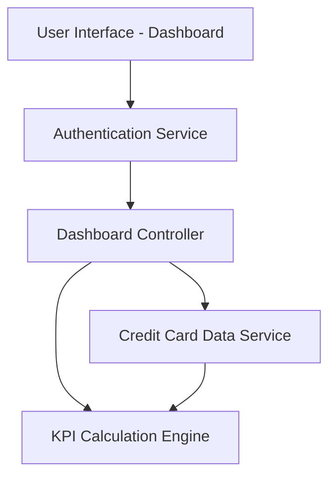

#### 1. High-Level Design

- **Summary:** This epic delivers a centralized, responsive dashboard that consolidates key performance indicators (KPIs) for a user's credit card portfolio. The dashboard displays monthly spend, total credit limit, available credit, and outstanding amounts across all cards, providing a unified view for monitoring financial health and credit utilization.

- **Component Flow:**

- **Integration Points:**
  - **Upstream:** User authentication service for secure access control
  - **Downstream:** Credit card data service for retrieving card balances and transaction data
  - **Internal:** KPI calculation engine for aggregating metrics across multiple cards

- **Key Assumptions:**
  - Credit card data service provides real-time or near-real-time data with sufficient freshness for dashboard display
  - Monthly spend is calculated based on transaction data within the current calendar month

- **NFR Highlights:** Dashboard must be responsive across desktop, tablet, and mobile devices; Page load time must be optimized for quick KPI display; UI must support real-time data refresh

#### 2. Validation Report

- **Requirements Coverage:** The design covers all stated requirements including dashboard interface, monthly spend calculation, credit limit aggregation, available credit computation, outstanding amount tracking, responsive layout, and multi-card consolidated view. The component flow demonstrates clear separation of concerns with authentication, data retrieval, and calculation layers.