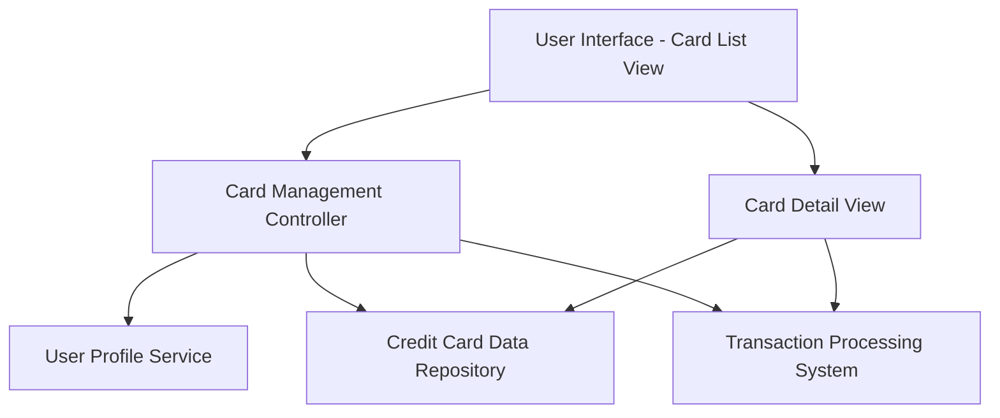

#### 1. High-Level Design

- **Summary:** This epic enables users to view and manage multiple credit cards within a single interface. Users can access individual card details, track card-specific spending patterns, monitor credit limits, available credit, and outstanding balances for each card. The feature supports card switching and provides card-wise spend analysis to optimize card utilization.

- **Component Flow:**

- **Integration Points:**
  - **Upstream:** User profile service to associate cards with user accounts
  - **Downstream:** Credit card data repository for storing and retrieving card information
  - **Downstream:** Transaction processing system for card-specific transaction data and spend analysis

- **Key Assumptions:**
  - Card data is pre-registered in the system; this epic does not handle new card registration with banks
  - Monthly spend trends are calculated based on historical transaction data available in the transaction processing system

- **NFR Highlights:** System must support display of unlimited number of credit cards per user; Card data retrieval must be efficient with minimal latency; Interface must maintain performance with increasing number of cards

#### 2. Validation Report

- **Requirements Coverage:** The design addresses all requirements including multiple credit card display, individual card detail views, card-wise spend analysis, card selection and navigation, card-specific balance tracking, and monthly spend trends per card. The architecture supports scalability for unlimited cards through efficient data retrieval patterns.