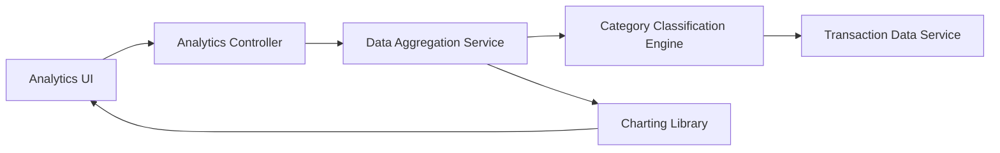

#### 1. High-Level Design

- **Summary:** This epic provides interactive visualizations and analytics to help users understand spending patterns through category-wise analysis and monthly trend tracking. The system categorizes spending across nine predefined categories (Food & Dining, Fuel, Shopping, Travel, Entertainment, Utilities, Healthcare, Education, Miscellaneous) and provides card-wise spend analysis with interactive charts supporting drill-down capabilities.

- **Component Flow:**

- **Integration Points:**
  - **Upstream:** Transaction data service for retrieving raw spending data; Category classification engine or service for categorizing transactions
  - **Downstream:** Data aggregation service for calculating trends and summaries; Charting library for rendering visualizations

- **Key Assumptions:**
  - Transaction categorization is either pre-assigned in the transaction data or performed by a classification engine using merchant codes or rule-based logic.
  - Historical data for up to 12 months is readily accessible and aggregated at monthly intervals for trend analysis.

- **NFR Highlights:** Analytics visualizations must render within 3 seconds; charts must be interactive with drill-down capabilities; supports data aggregation for up to 12 months of historical data; visualizations responsive across all device types.

#### 2. Validation Report

- **Requirements Coverage:** The design comprehensively covers all functional requirements including category-wise visualization, monthly trend analysis, card-wise spend analysis, interactive charts, and spending pattern identification across all nine specified categories. The architecture supports the NFRs for visualization performance (3-second render time), interactivity (drill-down), historical data support (12 months), and responsive design. All integration points with transaction data service, category classification engine, data aggregation service, and charting library are clearly defined and align with stated dependencies.