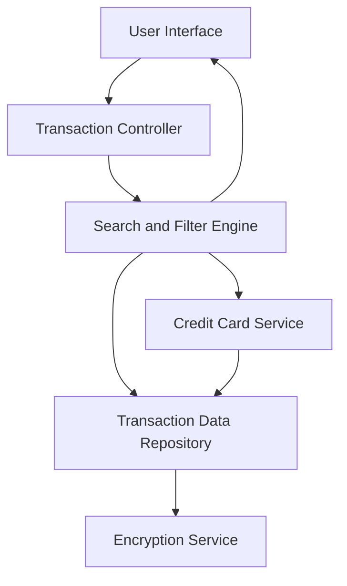

#### 1. High-Level Design

- **Summary:** This epic enables comprehensive transaction management capabilities, allowing users to view, search, and filter credit card transactions across all cards. Users can access detailed transaction history, apply filters by card and date range, and view individual transaction details to track spending activities and identify patterns or anomalies.

- **Component Flow:**

- **Integration Points:**
  - **Upstream:** Credit card service for retrieving card-specific transaction data
  - **Downstream:** Transaction data repository for storing and querying transaction records; Date/time service for timestamp management and date range filtering

- **Key Assumptions:**
  - Transactions are stored with standardized attributes (amount, date, merchant, category, card ID) to enable consistent filtering and search.
  - Fuzzy search matching is implemented using a search library or algorithm that supports partial text matching on merchant names and descriptions.

- **NFR Highlights:** Transaction queries must return results within 1 second; system must handle up to 10,000 transactions per user; transaction data encrypted at rest; search supports fuzzy matching.

#### 2. Validation Report

- **Requirements Coverage:** The design addresses all functional requirements including transaction listing, search, filtering (by card and date range), detail view, and multi-card aggregation. The architecture supports the stringent NFRs for query performance (1-second response time), scalability (10,000 transactions per user), and security (encryption at rest). Integration points with transaction repository and credit card service are properly identified and align with stated dependencies.