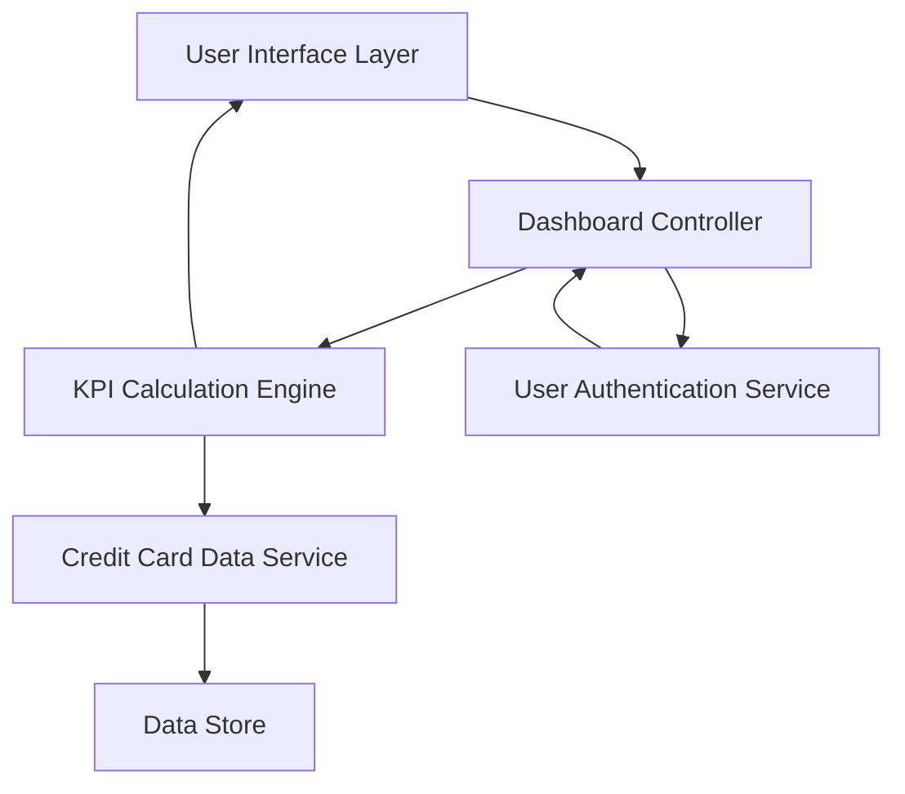

#### 1. High-Level Design

- **Summary:** This epic delivers a consolidated dashboard displaying key performance indicators (KPIs) for credit card management, including monthly spend, total credit limit, available credit, and outstanding amounts. The dashboard provides real-time financial metrics across multiple credit cards in a single, responsive interface to support informed financial decision-making.

- **Component Flow:**

- **Integration Points:**
  - **Upstream:** User authentication service for secure access to personal financial data
  - **Downstream:** Credit card data source or database for retrieving card details, limits, balances, and transaction data

- **Key Assumptions:**
  - Credit card data is available in a structured format with standardized fields for limit, balance, and transaction amounts.
  - Real-time data refresh is achieved through periodic polling or event-driven updates from the credit card data source.

- **NFR Highlights:** Dashboard must load within 2 seconds; supports real-time data refresh; responsive design for mobile, tablet, and desktop; data accuracy and consistency across all KPI displays.

#### 2. Validation Report

- **Requirements Coverage:** The design fully covers the epic's stated scope by including all required KPIs (monthly spend, total credit limit, available credit, outstanding amounts), multi-card view capability, and responsive layout. The architecture supports the NFRs for performance (2-second load time), real-time refresh, and cross-device responsiveness. Integration points with authentication and credit card data services are clearly identified and align with the stated dependencies.