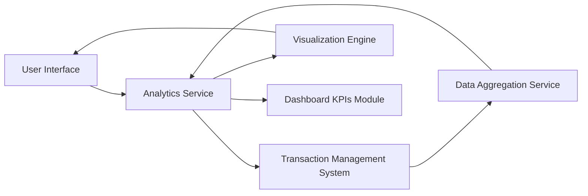

#### 1. High-Level Design

- **Summary:** This epic delivers interactive visualizations and analytics capabilities to help users understand spending patterns across multiple categories (Food & Dining, Fuel, Shopping, Travel, Entertainment, Utilities, Healthcare, Education, Miscellaneous). Users can analyze monthly spend trends, view card-wise spend breakdowns, and gain actionable insights through visual and interactive charts to optimize credit card usage and identify potential savings.

- **Component Flow:**

- **Integration Points:**
  - **Upstream:** Transaction Management System (source of transaction data for analytics)
  - **Downstream:** Dashboard KPIs Module (for consistent spending metrics)
  - Data Aggregation Service (for computing category totals, trends, and spending patterns)

- **Key Assumptions:**
  - Transaction categorization is pre-assigned by the transaction data service or a separate categorization engine.
  - Visualization library supports interactive drill-down capabilities and is compatible with responsive design requirements.

- **NFR Highlights:** Visualizations must render efficiently even with large datasets; Interactive charts must be responsive and support drill-down capabilities; Analytics calculations must be accurate and consistent with transaction data.

#### 2. Validation Report

- **Requirements Coverage:** The design covers all scope elements including monthly spend trend visualization, card-wise spend analysis, category-wise spending breakdown across all specified categories, interactive charts and graphs, and spending pattern identification. The architecture supports integration with the transaction management system, dashboard KPIs, and data aggregation service as specified in dependencies. The NFRs related to efficient rendering, responsive interactivity, and calculation accuracy are addressed through the Visualization Engine and Analytics Service components.