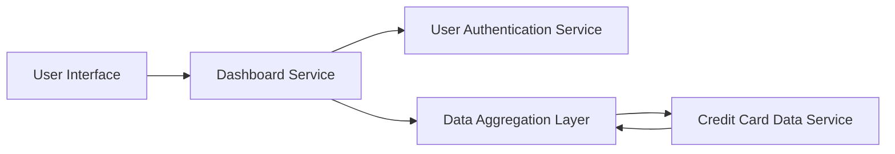

#### 1. High-Level Design

- **Summary:** This epic delivers a consolidated dashboard that displays key performance indicators (KPIs) for the user's credit card portfolio, including monthly spending, total credit limit, available credit, and outstanding amounts. The dashboard provides a responsive, at-a-glance view of financial health metrics across multiple credit cards to support informed credit usage decisions.

- **Component Flow:**

- **Integration Points:**
  - **Upstream:** User Authentication Service (for secure access to financial data)
  - **Downstream:** Credit Card Data Service (for retrieving card details, balances, limits, and transaction data)
  - Data Aggregation Layer for computing KPIs from raw credit card data

- **Key Assumptions:**
  - Credit card data is available via a REST API or similar interface with standardized data format (JSON/XML).
  - Dashboard refresh frequency is configurable and defaults to near real-time (e.g., polling every 30-60 seconds or event-driven updates).

- **NFR Highlights:** System must support responsive design across desktop, tablet, and mobile devices; Dashboard load time must be optimized for quick access; Data refresh should be near real-time for accurate financial insights.

#### 2. Validation Report

- **Requirements Coverage:** The design covers all stated scope elements including dashboard KPIs display, monthly spend tracking, total credit limit calculation, available credit computation, outstanding amount tracking, multiple credit card view, and responsive layout design. The architecture supports integration with credit card data service and user authentication service as specified in dependencies. The responsive design NFR is addressed through the UI layer, and near real-time data refresh is supported via the data aggregation layer.