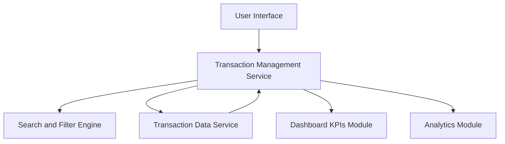

#### 1. High-Level Design

- **Summary:** This epic provides comprehensive transaction tracking capabilities across all credit cards, enabling users to view, search, filter, and analyze transaction history in a centralized interface. The system supports card-wise transaction segregation and feeds data into the spending analytics module to help users understand spending behavior and identify patterns.

- **Component Flow:**

- **Integration Points:**
  - **Upstream:** Credit Card Transaction Data Service (for retrieving transaction details)
  - **Downstream:** Dashboard KPIs module (for aggregated spending calculations)
  - **Downstream:** Analytics Module (for category-wise analysis and spending pattern identification)

- **Key Assumptions:**
  - Transaction data includes standard fields such as transaction ID, date, amount, merchant, card ID, and category.
  - Transaction history is retained for a defined period (e.g., 12-24 months) with archival strategy for older data.

- **NFR Highlights:** System must handle high volume of transaction records efficiently; Transaction queries must return results within acceptable response times; Data integrity must be maintained for all transaction records.

#### 2. Validation Report

- **Requirements Coverage:** The design addresses all scope elements including transaction listing, viewing across multiple cards, search and filtering, transaction history display, and card-wise transaction segregation. The architecture supports integration with the transaction data service, dashboard KPIs, and analytics module as specified in dependencies. The NFRs related to high volume handling, query performance, and data integrity are supported through the Transaction Management Service and Search/Filter Engine components.