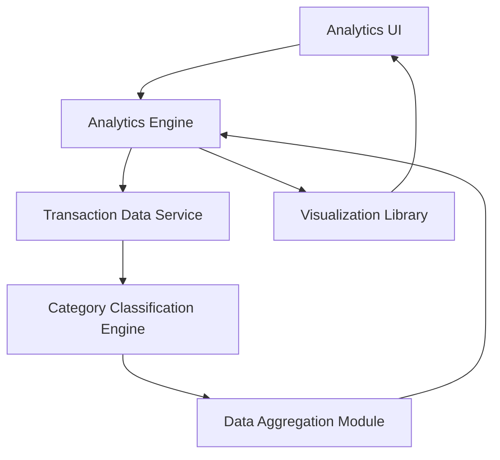

#### 1. High-Level Design

- **Summary:** This epic delivers advanced analytics and visualization capabilities to help users understand spending patterns through interactive charts and category-wise analysis. The core requirement is to provide spending insights across nine predefined categories with monthly trend analysis and actionable intelligence for budget management.

- **Component Flow:**

- **Integration Points:** 
  - **Upstream:** Transaction Data Service (for retrieving and categorizing transaction records)
  - **Upstream:** Data Visualization Library (for interactive charts)
  - **Upstream:** Category Classification Engine (for accurate spending categorization)

- **Key Assumptions:** 
  - Transactions are pre-classified or classified on-the-fly into one of nine categories using predefined rules or ML models.
  - Monthly trends are calculated based on historical transaction data available in the system.

- **NFR Highlights:** Analytics engine must process and aggregate transaction data efficiently for real-time insights; visualizations must render quickly with large datasets; system must support historical trend analysis for monthly spending patterns.

- **Data Flow:** User requests spending insights → Analytics Engine retrieves transaction data from Transaction Data Service → Category Classification Engine categorizes transactions into nine categories (Food & Dining, Fuel, Shopping, Travel, Entertainment, Utilities, Healthcare, Education, Miscellaneous) → Data Aggregation Module computes category-wise spending and monthly trends → Visualization Library generates interactive charts → Analytics UI displays spending patterns, trends, and actionable insights to the user.

#### 2. Validation Report

- **Requirements Coverage:** The design fully addresses the epic's scope including category-wise spending visualization, monthly spend trend analysis, interactive charts, nine-category tracking, transaction data aggregation, and spending pattern identification. All NFRs regarding efficient data processing, quick visualization rendering, and historical trend support are covered through the component architecture and integration points.