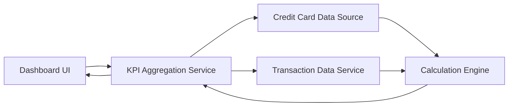

#### 1. High-Level Design

- **Summary:** This epic creates a modern, responsive dashboard serving as the central interface for monitoring credit card portfolio health. The core requirement is to provide consolidated KPIs including monthly spend, total credit limit, available credit, and outstanding amounts across all cards with real-time visibility.

- **Component Flow:**

- **Integration Points:** 
  - **Upstream:** Credit Card Data Sources (for retrieving card details, balances, and limits)
  - **Upstream:** Transaction Data Service (for calculating monthly spend metrics)

- **Key Assumptions:** 
  - Monthly spend is calculated based on current calendar month transactions.
  - Real-time data refresh implies periodic polling or event-driven updates from data sources.

- **NFR Highlights:** Responsive layouts across desktop, tablet, and mobile devices; optimized dashboard load time for quick KPI access; real-time data refresh capability for accurate financial metrics.

- **Data Flow:** User accesses dashboard → KPI Aggregation Service fetches card details from Credit Card Data Source and transaction data from Transaction Data Service → Calculation Engine computes monthly spend, aggregates total credit limits, calculates available credit, and tracks outstanding amounts → Dashboard UI displays consolidated KPIs with real-time updates across all cards in a responsive layout.

#### 2. Validation Report

- **Requirements Coverage:** The design comprehensively covers all stated requirements including dashboard interface, monthly spend calculation, credit limit aggregation, available credit computation, outstanding amount tracking, responsive layout, and multi-card consolidated view. All NFRs for responsive design, load time optimization, and real-time refresh are addressed through the architectural components.