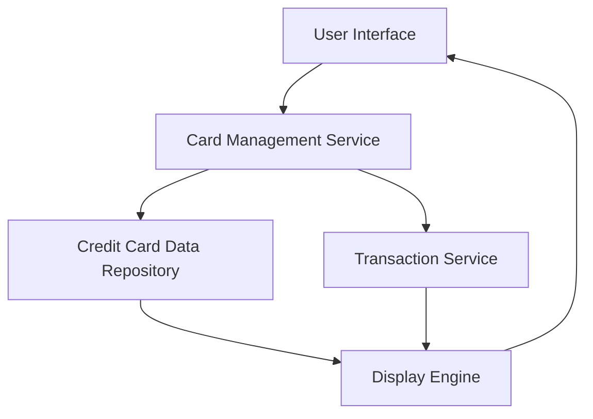

#### 1. High-Level Design

- **Summary:** This epic delivers a comprehensive credit card management interface that allows users to view and manage multiple credit cards within a unified system. The core requirement is to provide detailed card-specific information including spending, limits, balances, and enable effective portfolio monitoring with card-wise spend analysis.

- **Component Flow:**

- **Integration Points:** 
  - **Upstream:** Credit Card Data Repository (for storing and retrieving card information)
  - **Downstream:** Transaction Service (for card-wise spending calculations)

- **Key Assumptions:** 
  - Card data is assumed to be stored in a structured format with unique identifiers for each card.
  - Transaction service provides real-time or near-real-time spending data aggregated by card.

- **NFR Highlights:** System must handle multiple cards simultaneously without performance degradation; secure storage and display of card data; responsive interface with increasing card count.

- **Data Flow:** User requests card portfolio view → Card Management Service retrieves card details from Credit Card Data Repository and spending data from Transaction Service → Display Engine aggregates and formats the data → User Interface presents consolidated card information with individual card metrics including balances, limits, and card-specific spending analysis.

#### 2. Validation Report

- **Requirements Coverage:** The design fully covers the epic's stated scope including multiple credit card display, card-wise spend analysis, individual card details view, card information organization, and card-specific balance/limit tracking. All NFRs regarding performance, security, and responsiveness are addressed through the component architecture.