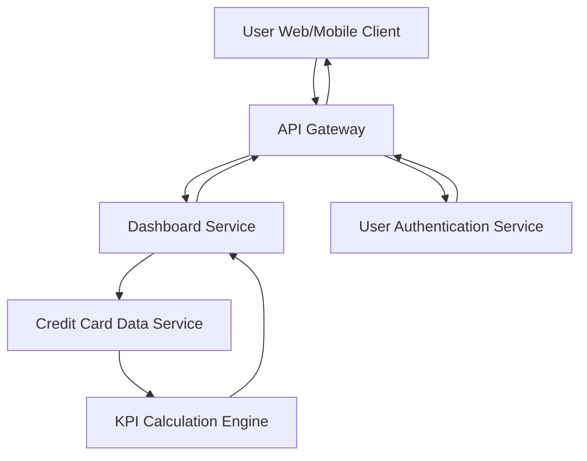

#### 1. High-Level Design

- **Summary:** This epic creates a consolidated credit card portfolio management dashboard that displays key performance indicators (KPIs) including monthly spend, total credit limit, available credit, and outstanding amounts across all user credit cards. The dashboard provides a comprehensive, at-a-glance view of the user's credit card portfolio, enabling quick assessment of financial position and credit health. The interface is designed to be modern, responsive, and accessible across desktop, tablet, and mobile devices, ensuring users can monitor their credit portfolio anytime, anywhere.

- **Component Flow:**

- **Integration Points:**
  - **Upstream:** Credit card data service for retrieving card details, balances, credit limits, and outstanding amounts
  - **Upstream:** User authentication service for secure access and user identity verification
  - **Internal:** KPI calculation engine for computing aggregated metrics (total credit limit, available credit, monthly spend, outstanding amount)
  - **Downstream:** Responsive UI framework for rendering dashboard across multiple device types

- **Key Assumptions:**
  - Credit card data is refreshed at regular intervals (e.g., daily or hourly) from the credit card data service; KPI calculations are based on the most recent available data snapshot.
  - User session management and authentication tokens are handled by the authentication service with appropriate timeout and security policies.

- **NFR Highlights:** System must support responsive design across desktop, tablet, and mobile devices; dashboard load time must be under 2 seconds; UI must be accessible and comply with WCAG 2.1 standards.

- **Data Flow:** User accesses dashboard through Web/Mobile Client → Request routed through API Gateway → User Authentication Service validates user identity and permissions → Dashboard Service requests credit card data from Credit Card Data Service → KPI Calculation Engine computes aggregated metrics (monthly spend, total credit limit, available credit, outstanding amount) → Dashboard Service formats response → API Gateway returns data to Client → Responsive UI renders KPI dashboard with all credit cards and consolidated metrics. Key inputs include user credentials and session tokens; outputs include KPI values, card list, and portfolio summary visualizations.

#### 2. Validation Report

- **Requirements Coverage:** The design fully addresses the epic's scope including dashboard KPI display (monthly spend, total credit limit, available credit, outstanding amount), multiple credit card view, consolidated credit card portfolio interface, and responsive layout for cross-device access. The architecture supports all NFR requirements: responsive design across desktop, tablet, and mobile devices; dashboard load time under 2 seconds; WCAG 2.1 accessibility compliance. All dependencies (credit card data service, user authentication service) are integrated into the component flow. Out-of-scope items (real bank integration, card payments, fund transfers, loans, payment gateway integration) are explicitly excluded as specified in the epic.