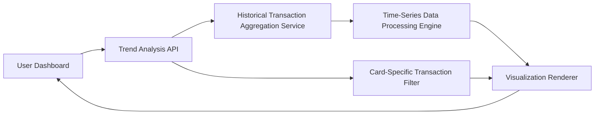

#### 1. High-Level Design

- **Summary:** This epic provides time-based spending trend analysis and card-specific spending breakdowns to enable users to understand their financial behavior over time. Users can visualize monthly spending trends to identify seasonal patterns, spending fluctuations, and compare performance across different time periods. The card-wise analysis feature allows users to see utilization patterns for each credit card, helping them optimize card usage based on benefits, rewards, or credit limits. The solution delivers both temporal and card-level granularity for comprehensive financial oversight.

- **Component Flow:**

- **Integration Points:**
  - **Upstream:** Historical transaction aggregation service for collecting and consolidating transaction data over time
  - **Internal:** Time-series data processing engine for analyzing spending trends across monthly intervals
  - **Internal:** Card-specific transaction filtering service for isolating transactions by individual credit card
  - **Downstream:** Visualization renderer for creating monthly trend charts and card-wise spending breakdowns

- **Key Assumptions:**
  - Monthly aggregation is calculated based on transaction posting date (not transaction date); time-series data is pre-aggregated for performance optimization.
  - "Real-time" card-wise analysis updates occur within an acceptable latency window (e.g., within minutes of transaction posting) rather than instantaneous updates.

- **NFR Highlights:** Trend analysis must support minimum 12 months of historical data; card-wise analysis must update in real-time when new transactions are posted; visualizations must be optimized for performance with large datasets.

- **Data Flow:** User selects time range and card filters through Dashboard UI → Trend Analysis API requests data from Historical Transaction Aggregation Service → Time-Series Data Processing Engine computes monthly spending totals and trends → Card-Specific Transaction Filter isolates transactions by card → Visualization Renderer generates trend charts and card-wise breakdowns → Interactive visualizations are displayed to user. Key inputs include user ID, date range, and card selection filters; outputs include monthly trend charts, card-wise spending comparisons, and historical pattern visualizations.

#### 2. Validation Report

- **Requirements Coverage:** The design comprehensively addresses the epic's scope including monthly spend trend visualization, time-series spending analysis, card-wise spending breakdown, comparative analysis across multiple cards, and historical spending pattern tracking. The architecture supports all NFR requirements: minimum 12 months of historical data, real-time updates for card-wise analysis, and performance optimization for large datasets. All dependencies (historical transaction aggregation service, time-series data processing engine, card-specific transaction filtering service) are integrated into the component flow. Out-of-scope items (real bank integration, payments, fund transfers, loans, payment gateway, predictive forecasts) are explicitly excluded as specified.