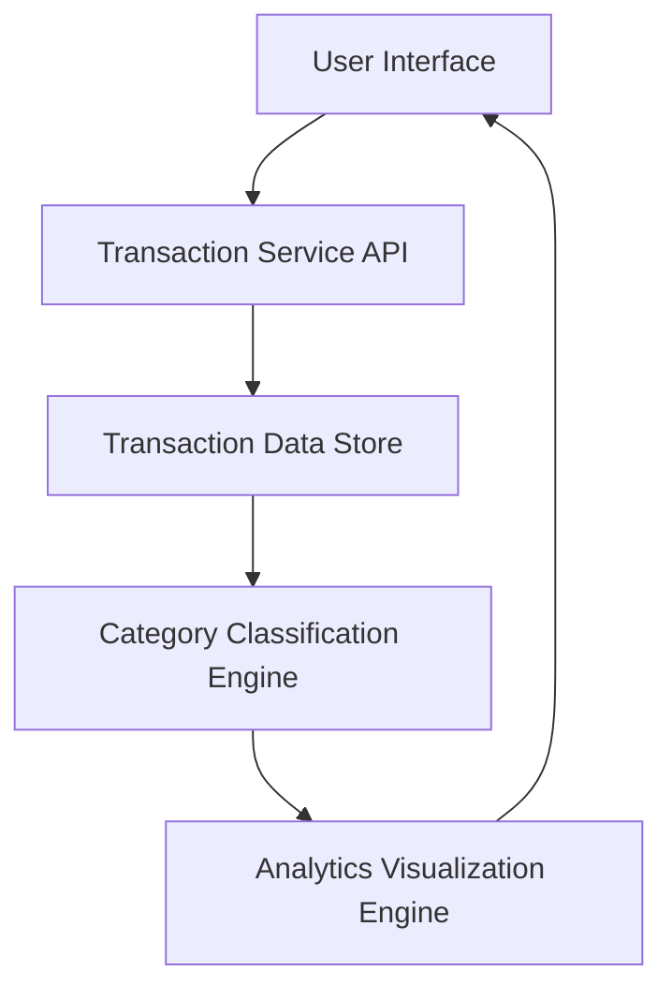

#### 1. High-Level Design

- **Summary:** This epic delivers a transaction monitoring and spending analytics capability that allows users to view detailed transaction histories across all their credit cards and analyze spending patterns through category-wise breakdowns. The system categorizes transactions into nine predefined categories (Food & Dining, Fuel, Shopping, Travel, Entertainment, Utilities, Healthcare, Education, Miscellaneous) and presents interactive visualizations to help users understand their spending behavior and make informed financial decisions.

- **Component Flow:**

- **Integration Points:**
  - **Upstream:** Transaction data service for retrieving historical transaction records (minimum 12 months)
  - **Internal:** Category classification engine for automatic assignment of transactions to spending categories
  - **Internal:** Analytics visualization library for rendering interactive charts and graphs
  - **Downstream:** User interface layer for presenting transaction lists and category-wise spending visualizations

- **Key Assumptions:**
  - Transaction data is pre-categorized by the classification engine or follows a consistent format that enables automated categorization; transaction updates occur in near real-time (within acceptable SLA).
  - Category assignment logic is deterministic and consistent across all transactions; users cannot manually re-categorize transactions in this epic scope.

- **NFR Highlights:** Analytics visualizations must render within 1.5 seconds; system must handle at least 12 months of transaction history; charts must be interactive and responsive across desktop, tablet, and mobile devices.

- **Data Flow:** User requests transaction data through the UI → Transaction Service API retrieves historical records from Transaction Data Store → Category Classification Engine processes and assigns categories to transactions → Analytics Visualization Engine aggregates category-wise spending and generates interactive charts → Rendered visualizations and transaction lists are displayed to the user in the UI. Key inputs include user authentication tokens and date range filters; outputs include categorized transaction lists and spending analytics charts.

#### 2. Validation Report

- **Requirements Coverage:** The design fully covers the epic's stated scope including transaction listing, category-wise spending visualization, interactive analytics charts, and spending pattern analysis across all nine predefined categories. The architecture supports the NFR requirements for 1.5-second render time, 12-month transaction history, and responsive design across all device types. All identified dependencies (transaction data service, category classification engine, analytics visualization library) are incorporated into the component flow. The design excludes out-of-scope items (real bank integration, payments, fund transfers, loans, payment gateway) as specified.