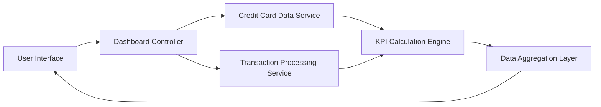

#### 1. High-Level Design

- **Summary:** This epic delivers a centralized dashboard that provides real-time visibility into key performance indicators (KPIs) for the user's credit card portfolio. The dashboard displays critical financial metrics including monthly spend, total credit limit, available credit, and outstanding amounts in a consolidated, responsive interface enabling quick assessment of overall credit card health.

- **Component Flow:**

- **Integration Points:**
  - **Upstream:** Credit Card Data Service (for retrieving card balances and credit limits)
  - **Upstream:** Transaction Processing Service (for monthly spend calculations and outstanding amounts)
  - **Internal:** KPI Calculation Engine (for aggregating metrics across multiple cards)
  - **Internal:** Data Aggregation Layer (for consolidating KPI data for dashboard display)

- **Key Assumptions:**
  - Real-time data refresh implies periodic polling or push notifications; exact refresh mechanism (WebSocket, polling interval) not specified.
  - Monthly spend is calculated based on current billing cycle; billing cycle start date determination not detailed.

- **NFR Highlights:** Dashboard must load within 2 seconds, support responsive design for mobile and desktop devices, handle real-time data refresh for KPI metrics.

- **Data Flow:** User accesses dashboard → Dashboard Controller initiates data requests → Credit Card Data Service retrieves current balances and credit limits → Transaction Processing Service calculates monthly spend and outstanding amounts → KPI Calculation Engine aggregates metrics (total credit limit, available credit, total outstanding) → Data Aggregation Layer consolidates KPIs → User Interface renders responsive dashboard with real-time KPI display.

#### 2. Validation Report

- **Requirements Coverage:** The design fully addresses the epic's scope including monthly spend display, total credit limit aggregation, available credit calculation, outstanding amount tracking, responsive dashboard layout, and consolidated KPI view. All NFRs (2-second load time, responsive design for mobile/desktop, real-time data refresh) are incorporated through optimized data retrieval and responsive UI framework. Integration dependencies (credit card data service, transaction processing service) are properly identified and mapped. Out-of-scope items (real bank integration, payment processing, fund transfers, payment gateway integration, loans) are explicitly excluded as specified in the epic.