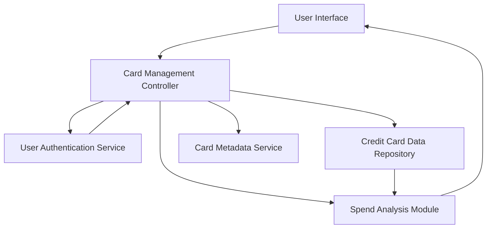

#### 1. High-Level Design

- **Summary:** This epic provides a unified interface for users to view and manage multiple credit cards (up to 10+ cards) from a single consolidated dashboard. Users can access card-specific details including individual limits, balances, spending patterns, and perform card-wise spend analysis and comparison across their credit card portfolio.

- **Component Flow:**

- **Integration Points:**
  - **Upstream:** Credit Card Data Repository (for card information, balances, limits)
  - **Upstream:** User Authentication Service (for secure card access and authorization)
  - **Upstream:** Card Metadata Service (for card details, card type, issuer information)
  - **Internal:** Spend Analysis Module (for card-wise spending calculations)

- **Key Assumptions:**
  - Card data is retrieved via API calls to backend services; data refresh frequency (real-time vs. periodic sync) not specified.
  - Card comparison functionality assumes standardized metrics (utilization %, spend, available credit); comparison criteria not detailed.

- **NFR Highlights:** System must support at least 10 credit cards per user, card data retrieval within 3 seconds, responsive interface across all device types.

- **Data Flow:** User logs in → User Authentication Service validates credentials → Card Management Controller requests card list for authenticated user → Credit Card Data Repository returns card information (balances, limits) → Card Metadata Service provides additional card details → Spend Analysis Module calculates card-wise spending patterns → User Interface displays consolidated multi-card view with individual card details and comparison capabilities.

#### 2. Validation Report

- **Requirements Coverage:** The design comprehensively addresses the epic's scope including multiple credit card display, card-wise spend analysis, individual card balance tracking, credit limit display, card comparison functionality, and detailed card views. All NFRs (10+ cards support, 3-second retrieval, responsive design) are incorporated through scalable architecture and performance-optimized data retrieval. Integration dependencies (credit card data repository, user authentication service, card metadata service) are properly mapped. Out-of-scope items (real bank integration, card payments, new card application, card activation, payment gateway) are explicitly excluded as specified.