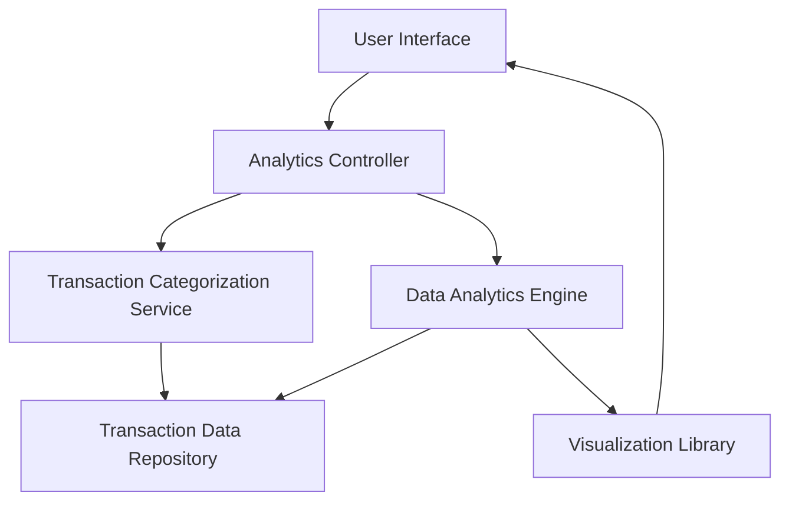

#### 1. High-Level Design

- **Summary:** This epic delivers an interactive analytics module that provides users with comprehensive spending insights across multiple categories (Food & Dining, Fuel, Shopping, Travel, Entertainment, Utilities, Healthcare, Education, Miscellaneous). The system enables category-wise breakdowns, monthly trend analysis, and visual representations to help users understand spending patterns and make informed financial decisions.

- **Component Flow:**

- **Integration Points:**
  - **Upstream:** Transaction Categorization Service (for automatic expense classification)
  - **Upstream:** Data Analytics Engine (for trend calculation and pattern analysis)
  - **Upstream:** Visualization Library (for chart rendering - e.g., Chart.js, D3.js, or similar)
  - **Data Source:** Transaction Data Repository (historical transaction data for at least 12 months)

- **Key Assumptions:**
  - Transaction categorization is automated using ML/rule-based service; manual re-categorization capability assumed but not specified.
  - Monthly trend data is pre-aggregated or computed on-demand with caching; real-time vs. batch processing not specified.

- **NFR Highlights:** Analytics visualizations must render within 2 seconds, support interactive filtering and drill-down, handle 12+ months of historical data, maintain 99.9% data accuracy.

- **Data Flow:** User requests spending analytics → Analytics Controller fetches transaction data from repository → Transaction Categorization Service classifies expenses into predefined categories → Data Analytics Engine computes monthly trends, aggregations, and patterns → Visualization Library renders interactive charts/graphs → User Interface displays category-wise breakdowns and trends with drill-down capabilities.

#### 2. Validation Report

- **Requirements Coverage:** The design fully covers the epic's stated scope including category-wise visualization (9 categories), monthly trend analysis, interactive charts, and spending pattern identification. All NFRs (2-second render time, interactive filtering, 12-month history, 99.9% accuracy) are addressed through appropriate component selection and architecture. Integration dependencies (categorization service, analytics engine, visualization library) are incorporated. Out-of-scope items (real bank integration, predictive analytics, budget recommendations, automated alerts) are explicitly excluded.