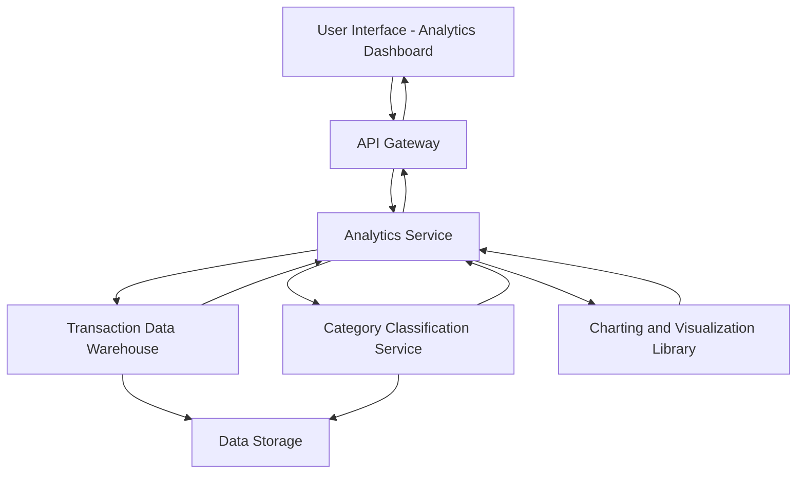

#### 1. High-Level Design

- **Summary:** This epic provides interactive analytics and visualization capabilities enabling users to understand spending patterns through monthly trend charts and category-wise breakdowns across nine predefined categories (Food & Dining, Fuel, Shopping, Travel, Entertainment, Utilities, Healthcare, Education, Miscellaneous). The system analyzes historical transaction data to deliver actionable insights for financial decision-making and expense optimization.

- **Component Flow:**

- **Integration Points:**
  - **Upstream:** Transaction data warehouse (provides historical spending data for at least 12 months)
  - **Upstream:** Category classification service (categorizes transactions into nine predefined categories)
  - **Upstream:** Charting and visualization library (renders interactive graphs and charts)
  - **Downstream:** User Interface (displays interactive visualizations and spending insights)

- **Key Assumptions:**
  - Transaction categorization uses rule-based or ML-based classification with merchant category codes (MCC) as primary input; manual recategorization capability assumed for user corrections.
  - Monthly spend trends are pre-aggregated in the data warehouse with incremental updates to optimize query performance within 3-second SLA.

- **NFR Highlights:** Analytics queries return results within 3 seconds; Handle 12+ months of historical data; Interactive responsive visualizations across all devices.

- **Data Flow:** User requests analytics view (monthly trends or category breakdown) → API Gateway routes to Analytics Service → Service queries Transaction Data Warehouse for historical transaction data (12+ months) → Category Classification Service enriches transactions with category labels (Food & Dining, Fuel, Shopping, Travel, Entertainment, Utilities, Healthcare, Education, Miscellaneous) → Analytics Service aggregates data by time period and category → Charting and Visualization Library formats data for interactive graphs → Analytics Service returns visualization-ready data through API Gateway → UI renders interactive charts enabling users to explore spending patterns, compare periods, and drill down into categories.

#### 2. Validation Report

- **Requirements Coverage:** The design fully satisfies the epic scope including monthly spend trend visualization, category-wise spending analysis across all nine categories, interactive charts and graphs, spending pattern identification, transaction categorization, and historical spending comparison. NFRs for 3-second query response, 12-month historical data handling, and responsive interactive visualizations are addressed through data warehouse architecture and pre-aggregation strategy. All dependencies (Transaction data warehouse, Category classification service, Charting and visualization library) are incorporated in the component flow with clear integration points.