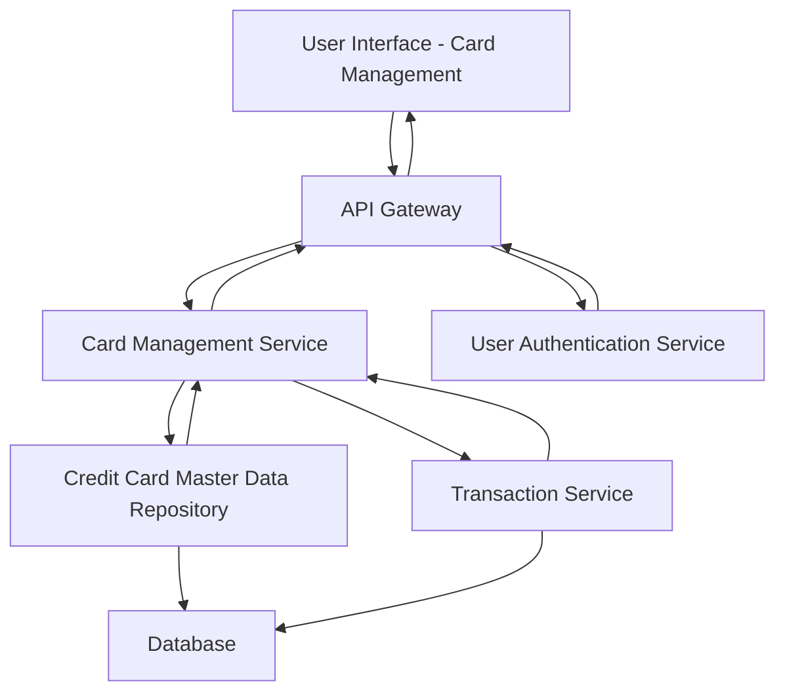

#### 1. High-Level Design

- **Summary:** This epic enables comprehensive multi-card portfolio management through a unified interface displaying detailed information for each credit card including card-specific limits, available credit, outstanding balances, and card-wise spending analysis. Users can view, compare, and analyze up to 10 credit cards simultaneously to optimize usage and maintain control over their portfolio.

- **Component Flow:**

- **Integration Points:**
  - **Upstream:** Credit Card master data repository (source of card details, limits, balances)
  - **Upstream:** User authentication service (secures card access with user identity verification)
  - **Upstream:** Transaction service (provides card-wise spending data and transaction history)
  - **Downstream:** User Interface (displays masked card information and portfolio comparison views)

- **Key Assumptions:**
  - Card numbers are stored encrypted and displayed with masking (e.g., last 4 digits visible) following PCI-DSS compliance patterns.
  - Card-wise spending analysis aggregates transactions by card identifier with daily batch processing and on-demand refresh capability.

- **NFR Highlights:** Support for at least 10 cards per user; Card data retrieval < 1 second; Secure storage with masked card numbers.

- **Data Flow:** User accesses card management interface → API Gateway validates session through User Authentication Service → Card Management Service retrieves card list from Credit Card Master Data Repository → For each card, service fetches card details (credit limit, available credit, outstanding balance) and card-wise spending from Transaction Service → Database provides card master data and transaction aggregates → Card Management Service compiles portfolio view with masked card numbers → Data returned through API Gateway → UI displays all cards with comparison capabilities and individual card performance metrics.

#### 2. Validation Report

- **Requirements Coverage:** The design comprehensively addresses all scope elements including multiple credit card display, card-wise spend analysis, individual card credit limit tracking, per-card available credit calculation, per-card outstanding balance display, and card comparison capabilities. NFRs for supporting 10 cards per user, sub-1-second retrieval, and secure masked display are integrated through service design and authentication layer. All dependencies (Credit Card master data repository, User authentication service, Transaction service) are explicitly mapped in the architecture.