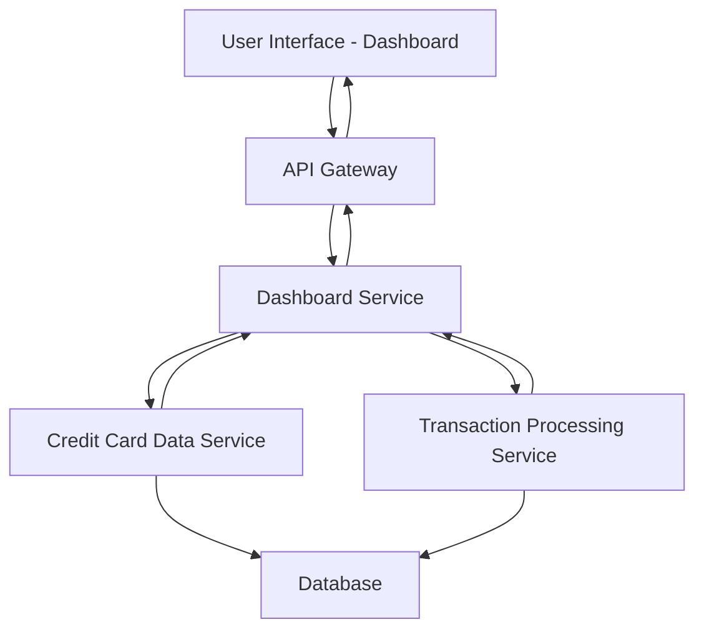

#### 1. High-Level Design

- **Summary:** This epic delivers a centralized dashboard providing real-time visibility into credit card portfolio health through key performance indicators including monthly spend, total credit limit, available credit, and outstanding amounts. The dashboard aggregates data from multiple credit cards to present a consolidated financial overview enabling informed decision-making.

- **Component Flow:**

- **Integration Points:**
  - **Upstream:** Credit Card data service (retrieves card details, balances, credit limits)
  - **Upstream:** Transaction processing service (provides monthly spend calculations and outstanding amounts)
  - **Downstream:** User Interface layer (consumes aggregated KPI data for display)

- **Key Assumptions:**
  - KPI calculations are performed server-side with cached results refreshed at configurable intervals (assumed real-time means near-real-time with acceptable latency).
  - Credit limit and balance data ownership resides in the Credit Card data service with transactional consistency guarantees.

- **NFR Highlights:** Dashboard load time < 2 seconds; Responsive design across desktop, tablet, mobile; Real-time data refresh for KPI metrics.

- **Data Flow:** User requests dashboard → API Gateway authenticates and routes request → Dashboard Service fetches card details from Credit Card Data Service and transaction summaries from Transaction Processing Service → Services query Database for card balances, limits, and transaction aggregates → Dashboard Service aggregates KPIs (monthly spend, total credit limit, available credit, outstanding amount) → Formatted KPI data returned through API Gateway → UI renders KPI widgets and cards with real-time refresh capability.

#### 2. Validation Report

- **Requirements Coverage:** The design fully covers the epic's stated scope including monthly spend display, total credit limit calculation, available credit tracking, outstanding amount visualization, responsive dashboard layout, and KPI widgets. All NFRs (2-second load time, responsive design, real-time refresh) are addressed through service architecture and caching strategy. Dependencies on Credit Card data service and Transaction processing service are explicitly integrated in the component flow.