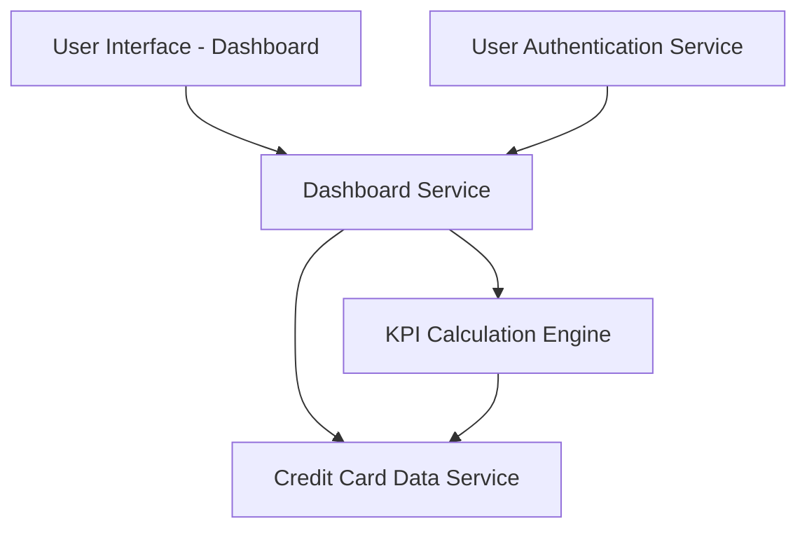

#### 1. High-Level Design

- **Summary:** This epic delivers a modern, responsive dashboard that serves as the central hub for credit card portfolio management. It provides consolidated KPI metrics including monthly spend, total credit limit, available credit, and outstanding amounts aggregated across all user credit cards. The dashboard enables at-a-glance financial health monitoring and proactive credit management.

- **Component Flow:**

- **Integration Points:**
  - **Upstream:** Credit Card Data Service (retrieves card details and balances)
  - **Upstream:** User Authentication Service (ensures secure access)
  - **Internal:** KPI Calculation Engine (computes aggregated metrics)

- **Key Assumptions:**
  - KPI metrics are calculated in real-time or near-real-time with appropriate caching to meet 2-second load time requirement
  - Credit card data is synchronized periodically from source systems to ensure data freshness

- **NFR Highlights:** System must support responsive design across desktop, tablet, and mobile devices; Dashboard load time must be under 2 seconds; Real-time data refresh capability for KPI metrics

- **Data Flow:** User authenticates and accesses dashboard → User Authentication Service validates credentials → Dashboard Service requests user's credit card data from Credit Card Data Service → KPI Calculation Engine aggregates metrics (monthly spend, total credit limit, available credit, outstanding amounts) across all cards → Calculated KPIs are cached for performance → Dashboard UI renders consolidated metrics in responsive layout → Real-time refresh mechanism updates KPIs periodically or on-demand → User views consolidated financial health at a glance across all devices.

#### 2. Validation Report

- **Requirements Coverage:** The design fully addresses all scope requirements including dashboard interface development, monthly spend calculation and display, total credit limit aggregation, available credit computation, outstanding amount tracking, responsive layout implementation, and multi-card consolidated view. All NFRs are satisfied: responsive design through modern UI framework supporting desktop/tablet/mobile, sub-2-second load time via KPI caching and optimized data retrieval, and real-time refresh capability through periodic data synchronization and on-demand refresh mechanisms.