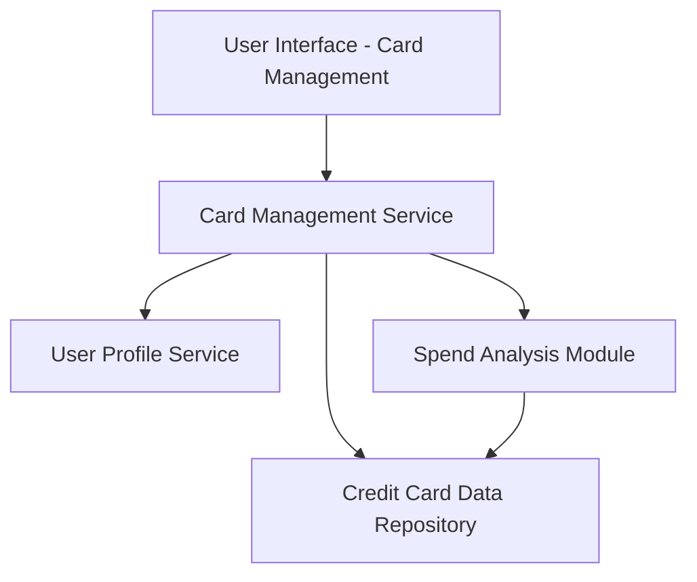

#### 1. High-Level Design

- **Summary:** This epic enables users to manage and view multiple credit cards within a unified interface. It provides comprehensive card-level visibility including individual card details, card-wise spend analysis, credit limits, outstanding balances, and card organization capabilities. Users can compare performance across cards and manage their entire credit portfolio from a single location.

- **Component Flow:**

- **Integration Points:**
  - **Upstream:** Credit Card Data Repository (stores and retrieves card information)
  - **Upstream:** User Profile Service (manages card-user associations)
  - **Internal:** Spend Analysis Module (provides per-card spending metrics)

- **Key Assumptions:**
  - Card numbers are stored in encrypted format and masked for display (showing only last 4 digits)
  - Card-user associations are maintained in the User Profile Service with appropriate access controls

- **NFR Highlights:** System must handle at least 20 credit cards per user without performance degradation; Card data retrieval must complete within 1 second; Secure storage and display of card information with masked card numbers

- **Data Flow:** User accesses card management interface → Card Management Service retrieves user's associated cards from User Profile Service → For each card, detailed information is fetched from Credit Card Data Repository → Spend Analysis Module calculates card-wise spending metrics → All card data is aggregated and formatted → UI displays list of cards with individual details, limits, balances, and spending → User can select, filter, or organize cards → Selected card details are displayed with masked card numbers for security.

#### 2. Validation Report

- **Requirements Coverage:** The design comprehensively addresses all scope items including multiple credit card display, card-wise spend analysis, individual card details view, card organization and listing, per-card credit limit tracking, per-card outstanding balance display, and card selection/filtering. All NFRs are met through appropriate service architecture: scalability to 20+ cards via efficient data retrieval patterns, 1-second response time through optimized queries and caching, and security through encryption and masking of sensitive card data.