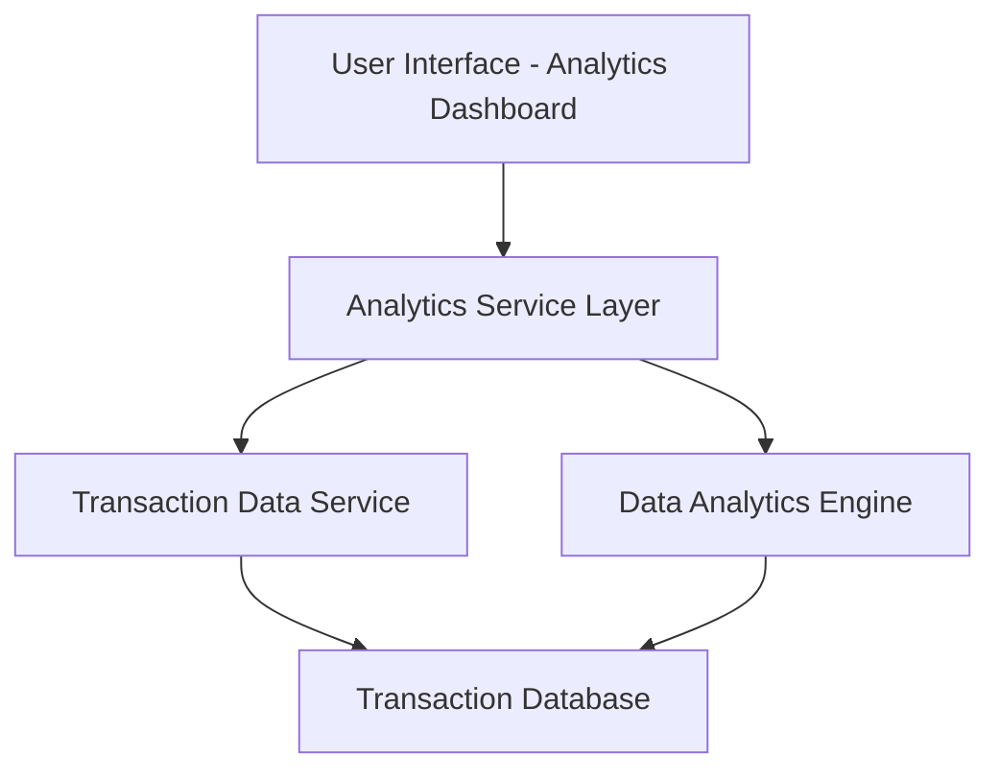

#### 1. High-Level Design

- **Summary:** This epic delivers an interactive analytics module that provides users with comprehensive spending insights through visualizations. It enables monthly trend analysis and category-wise spending breakdowns across 9 predefined categories (Food & Dining, Fuel, Shopping, Travel, Entertainment, Utilities, Healthcare, Education, Miscellaneous), helping users understand their financial behavior and optimize expenses.

- **Component Flow:**

- **Integration Points:**
  - **Upstream:** Transaction Data Service (provides categorized transaction history)
  - **Upstream:** Data Analytics Engine (performs trend calculations and aggregations)
  - **Downstream:** Visualization rendering library for charts and graphs

- **Key Assumptions:**
  - Transactions are pre-categorized at the time of ingestion or through an automated categorization service
  - Historical data retention policy supports at least 12 months of transaction history

- **NFR Highlights:** Analytics visualizations must render within 3 seconds; System must support historical data analysis for at least 12 months; Charts must be interactive and responsive across all device types

- **Data Flow:** User requests spending analytics → Analytics Service Layer retrieves transaction data from Transaction Data Service → Data Analytics Engine processes and aggregates transactions by category and time period → Aggregated data is formatted and returned to UI → Interactive charts and visualizations are rendered showing category-wise breakdowns and monthly trends → User can interact with visualizations to drill down into specific categories or time periods.

#### 2. Validation Report

- **Requirements Coverage:** The design fully covers the epic's stated scope including category-wise visualization, monthly trend analysis, interactive dashboard, spending breakdown across predefined categories, transaction categorization, trend analysis over time, and visual charts. All NFRs regarding rendering performance (3 seconds), historical data support (12 months), and responsive design are addressed through appropriate service layer architecture and caching strategies.